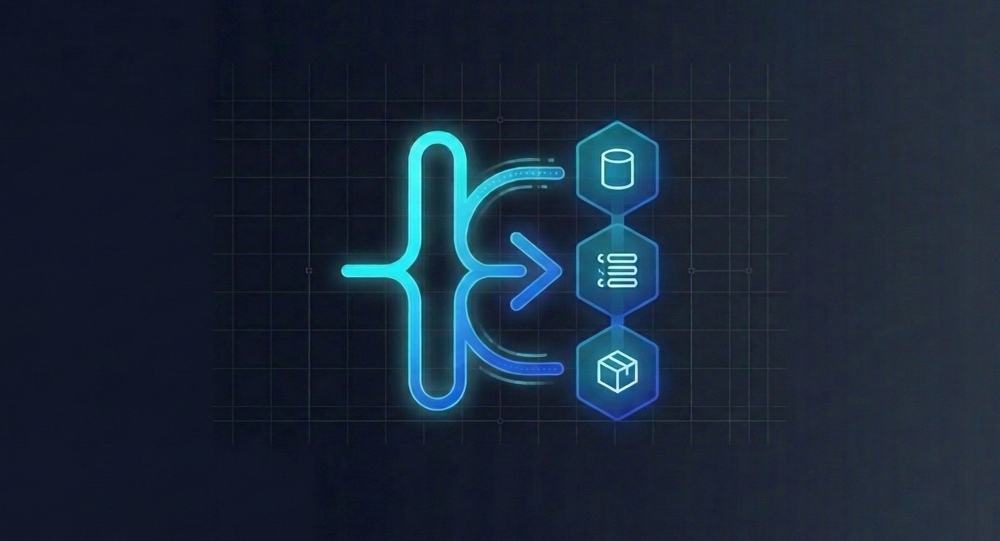
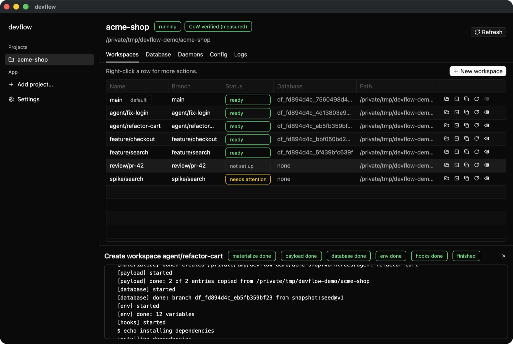
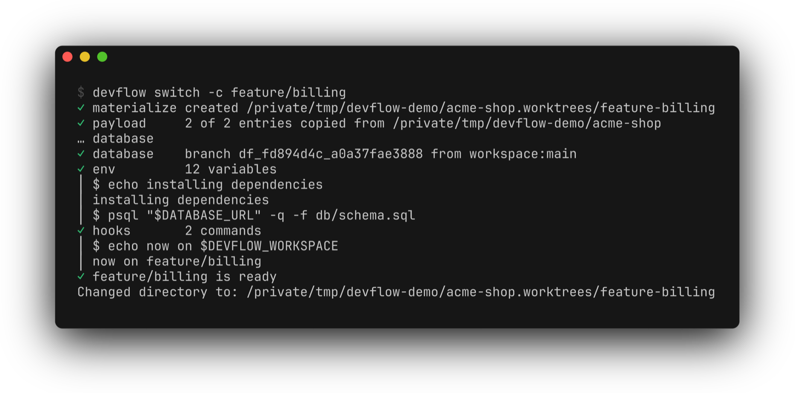

<p align="center">
  
</p>

<h1 align="center">devflow</h1>

<p align="center">Git worktrees with their own database, created in seconds.</p>

<p align="center">
  <a href="docs/guide/README.md">Guide</a> ·
  <a href="AGENTS.md">Agent contract</a> ·
  <a href="docs/MIGRATING.md">Migrating from 0.x</a> ·
  <a href="docs/guide/remote-data-hosts.md">Remote data hosts</a> ·
  <a href="docs/ARCHITECTURE.md">Architecture</a> ·
  <a href="CHANGELOG.md">Changelog</a>
</p>

<p align="center">
  
</p>

## What it does

devflow prepares an isolated development environment for each branch of a Git repository. It does four things, plus a desktop app:

1. **Worktrees.** Create, list and remove Git worktrees. Removal always refuses the default workspace and the one you are standing in. Dirty or locked worktrees need `--force`.
2. **Copy-on-write payloads.** Clone the ignored paths you list (`node_modules`, `.env`, build output) from the source worktree with APFS `clonefile` or Linux `FICLONE`. If the filesystem cannot share blocks, devflow copies.
3. **Data branches.** One PostgreSQL 18 server per project, and a Valkey, Redis or MySQL container or a SQLite file per workspace. Each workspace gets its own database, created with `CREATE DATABASE … TEMPLATE … STRATEGY FILE_COPY` and `file_copy_method = clone`, so on a reflink filesystem the new database shares blocks with its source.
4. **Hooks and environment.** Trusted shell commands with `DATABASE_URL` in the environment: `setup` runs once in a new worktree, `switch` on every `devflow switch` into a ready workspace, `teardown` before removal. The generated `.devflow/env` also holds `COMPOSE_PROJECT_NAME` and a port of its own for each workspace (`DEVFLOW_PORT`), and an `[env]` section adds your variables to it: recipes such as `DIRECT_URL`, and framework presets (Prisma, Laravel, Spring, SQLAlchemy).

`devflow-gui` is a native desktop app (GPUI) over the same core: projects, workspaces, data services with their branches and snapshots, processes, setup logs and config editing ([the app](docs/guide/desktop-app.md)).

### Why so little

The [jdx](https://github.com/jdx) tools now cover the rest, so devflow no longer builds it:

| Need | Use |
| --- | --- |
| Run dev servers, workers and schedulers; HTTPS names like `web.df-0b3c9d2e-a1b2c3d4.localhost` | [pitchfork](https://pitchfork.jdx.dev) daemons and its proxy |
| Install toolchains and dependencies, run tasks | [mise](https://mise.jdx.dev): `mise install`, `mise deps`, `mise run` |
| Share Rust build caches between checkouts | [Mr. Boxington](https://mr-boxington.jdx.dev) (`mbx`) |

None of them creates a worktree, prepares it, or branches database data. devflow does that and writes `.devflow/env` so those tools can pick up the result.

## Install

devflow embeds libgit2, so the `git` binary is not required (the opt-in native checkout, [`[worktree] checkout = "git"`](docs/guide/configuration.md#the-native-checkout), uses it). Managed Postgres needs Docker (or a compatible engine such as OrbStack); external mode needs a PostgreSQL 18 server instead. pitchfork and mise are optional; `devflow doctor` checks the oldest release of each that devflow supports ([which](docs/guide/processes.md#supported-releases)).

> **This README describes devflow 1.0, which is not published as a release yet.** The latest published release is **0.8.0**, which reads another configuration format (see [docs/MIGRATING.md](docs/MIGRATING.md)): the installer below fetches it and warns after installing a 0.x release. To use 1.0, build it from source.

```sh
# from source: this is devflow 1.0
git clone https://github.com/clement-tourriere/devflow.git && cd devflow
cargo install --path .

# latest published release (0.x until 1.0 is released; Linux x86_64/arm64, macOS Apple Silicon) -> ~/.local/bin
curl -fsSL https://raw.githubusercontent.com/clement-tourriere/devflow/main/scripts/install.sh | sh

# desktop app (macOS 15+; not part of the release binaries)
cargo build --release -p devflow-gui        # target/release/devflow-gui
```

`devflow gui` starts the app; `devflow-gui` must be next to the `devflow` binary or on `PATH`. Linux needs Wayland or X11 with Vulkan for the GUI and is not yet advertised as supported. Set `DEVFLOW_INSTALL_DIR` or `DEVFLOW_VERSION` to change the installer's target or pin a release.

Optional shell integration, so `devflow switch` changes your directory (and `devflow switch -` goes back), and workspace names complete when you press Tab ([details](docs/guide/workspaces.md#shell-integration)):

```sh
eval "$(devflow shell-init zsh)"     # or bash, fish
eval "$(devflow completions zsh)"    # Tab completes workspace names for switch, path, remove, up, down, ps and open
```

## Quick start

```sh
cd ~/code/shop                        # any Git repository
devflow init                          # proposes a setup from what the repository contains, you review it, then it writes devflow.toml
devflow db up                         # start the project's PostgreSQL 18 container
devflow trust                         # review and approve what the project runs: hooks, [env], pitchfork processes
devflow switch -c feature/x           # worktree + payload + database branch + .devflow/env + setup hooks
devflow list                          # workspaces, status, database, path (--wide: changes, port, containers, daemons)
devflow up                            # start the workspace's pitchfork daemons (approved, ready workspaces only)
devflow ps                            # daemon, state, port, URL
devflow remove feature/x              # stops its daemons, teardown hooks, drops the branch's database, removes the worktree
```

<p align="center">
  
</p>

`devflow switch -c` prints the new worktree path (`devflow path feature/x` prints it again). The directory is the sanitized workspace name (`feature/x` becomes `feature-x`), so use the printed path rather than building it. The generated `.devflow/env` holds `DATABASE_URL`, the `PG*` variables and `DEVFLOW_*` identifiers; the directory ignores itself, so it never shows up in `git status`.

## The daily commands

- **`devflow switch [-c] [NAME]`** creates (`-c`) or enters a workspace and sets it up: it resumes at the first unfinished phase, so running it again is safe. Without a name it opens a picker at a terminal; `switch -` goes back to the previous workspace. `--from WS` chooses where the code and payload come from and `--data-from WS|snapshot:NAME[@vN]|branch:ID|empty` where the data comes from (both are fixed once chosen); `--base REF` chooses where a new branch starts; `--no-db` and `--no-hooks` skip those phases. [Workspaces](docs/guide/workspaces.md).
- **`devflow list [--wide|--all]`** shows each workspace's status from local files only, so it is fast and works offline. `--wide` adds uncommitted changes, ahead/behind, advisory merge evidence, last activity, port, containers and daemons; `--all` lists every registered project.
- **`devflow exec [--workspace NAME] -- CMD`** runs a command with the workspace's `.devflow/env` applied last, over whatever mise, a profile or the shell set, from any subdirectory. It refuses to start the command without that file instead of running it against the wrong database: `devflow exec -- npm test`, or `mise exec -- devflow exec -- bun install` inside mise. [Hooks, environment and trust](docs/guide/hooks-env-trust.md).
- **`devflow remove NAME`** checks every protection before changing anything (dirty or locked worktree, untrusted teardown hooks, an unmerged branch with `--delete-branch`, data it cannot account for), stops the workspace's daemons, runs `teardown`, drops the data branches this workspace created (`--keep-data` keeps them) and removes the worktree. `--force` overrides the protections; it never overrides the default workspace or the one you are standing in.
- **`devflow gc [--remove ID…]`** finds workspaces whose worktree Git or an agent host removed (T3 Code, Cursor, Codex and `git worktree remove` do not tell devflow) and shows what they still own: database branches, containers, daemons, with sizes and advisory merge evidence. Alone it changes nothing; `--remove ID…` removes the ones you name (`--snapshot` keeps a snapshot of each data branch first).
- **`devflow integrate [HOST]`** makes an agent host set every new worktree up with devflow before its agent starts: `t3`, `claude`, `conductor` or `cursor`. It writes the host's project file additively, shows the change first (`--print` writes nothing) and never replaces a script that is not devflow's. `devflow wait` and `exec --wait` cover the scripts and agents that need a workspace another tool is still setting up. [Agents and hosts](docs/guide/agents-and-hosts.md).

Every command that inspects or changes something accepts `--json` and prints one versioned document ([the contract for agents](AGENTS.md)). The [command overview](docs/guide/commands.md) lists the rest, and `devflow --help` has the flags.

## A minimal configuration

`devflow init` writes `devflow.toml` for you; this is what a small one looks like (the [configuration guide](docs/guide/configuration.md) and [`examples/`](examples) have complete ones):

```toml
#:schema https://raw.githubusercontent.com/clement-tourriere/devflow/main/docs/devflow.schema.json
[project]
name = "shop"
id = "0b3c9d2e-…"                # written by `devflow init`

[worktree]
dir = "../{project}.worktrees"   # relative to the main checkout; absolute and ~/ paths work too
copy = [".env", "node_modules"]  # cloned from the source worktree; omit to copy nothing

[services.db]                    # a service is a table named by its key, selected by its engine
engine = "postgres"              # postgres, valkey, redis, mysql (preview) or sqlite
mode = "managed"                 # or "external"
image = "postgres:18"

[hooks]
setup = [
  "mise install",
  "mise exec -- devflow exec -- bun install",
  { name = "migrate", run = "mise exec -- devflow exec -- bun run db:migrate", timeout = "5m" },
]

[env]
DIRECT_URL = "${DATABASE_URL}"   # a recipe: devflow-generated variables, referenced once
presets = ["spring"]             # or prisma, laravel, sqlalchemy, db_parts
```

`devflow.toml` has a JSON Schema ([`docs/devflow.schema.json`](docs/devflow.schema.json); `devflow config schema` prints it). Editors that understand TOML schemas (taplo, Even Better TOML) complete the keys and mark an unknown one when the file starts with the `#:schema` line above; the [guide](docs/guide/configuration.md#editor-support-the-json-schema) has the `.taplo.toml` form and the schema of `devflow.local.toml`, the git-ignored file for machine-local overrides.

Each workspace runs its own branch's `[hooks]`, `[env]` and `[worktree] copy`; the project itself (`[project]`, `[services.*]`, `[data]`, `[integrations]`, `[pitchfork] autostart` and `[worktree]` apart from `copy`) comes from the main checkout, which a branch never overrides ([which configuration a workspace runs](docs/guide/configuration.md#which-configuration-a-workspace-runs)).

## Documentation

| Where | What |
| --- | --- |
| [docs/guide/](docs/guide/README.md) | The guide, one page per topic: configuration, workspaces, data services ([PostgreSQL](docs/guide/postgresql.md), [Valkey and Redis](docs/guide/valkey-redis.md), [MySQL](docs/guide/mysql.md), [SQLite](docs/guide/sqlite.md)), hooks, environment and trust, processes, agents and hosts, [remote data hosts](docs/guide/remote-data-hosts.md), copy-on-write, the desktop app, [troubleshooting](docs/guide/troubleshooting.md) |
| [AGENTS.md](AGENTS.md), [docs/agents-reference.md](docs/agents-reference.md) | The automation contract (JSON envelope, exit codes, remedies, the agent flow), and every command's document shape, field and refusal |
| [docs/MIGRATING.md](docs/MIGRATING.md) | Coming from 0.x or from an earlier 1.0 build |
| [docs/ARCHITECTURE.md](docs/ARCHITECTURE.md), [CONTRIBUTING.md](CONTRIBUTING.md), [SECURITY.md](SECURITY.md), [CHANGELOG.md](CHANGELOG.md) | The module map, how to work on devflow, the security model, the release notes |
| [`examples/`](examples) | A sample `devflow.toml`, an external-server one, `mise.toml`, `pitchfork.toml` and [`agent-task.sh`](examples/agent-task.sh) |

## What changed in 1.0

1.0 is a deliberate simplification: process supervision, the proxy, the TUI, Jujutsu, cloud providers, baselines, hook templating and the Tauri app are gone, and PostgreSQL, Valkey, Redis, MySQL and SQLite are branched by one set of rules. 1.0 reads `devflow.toml` (or `.devflow.toml`) plus `devflow.local.toml` and never adopts 0.x resources. [docs/MIGRATING.md](docs/MIGRATING.md) lists each replacement and how to move your data.

## License

MIT
