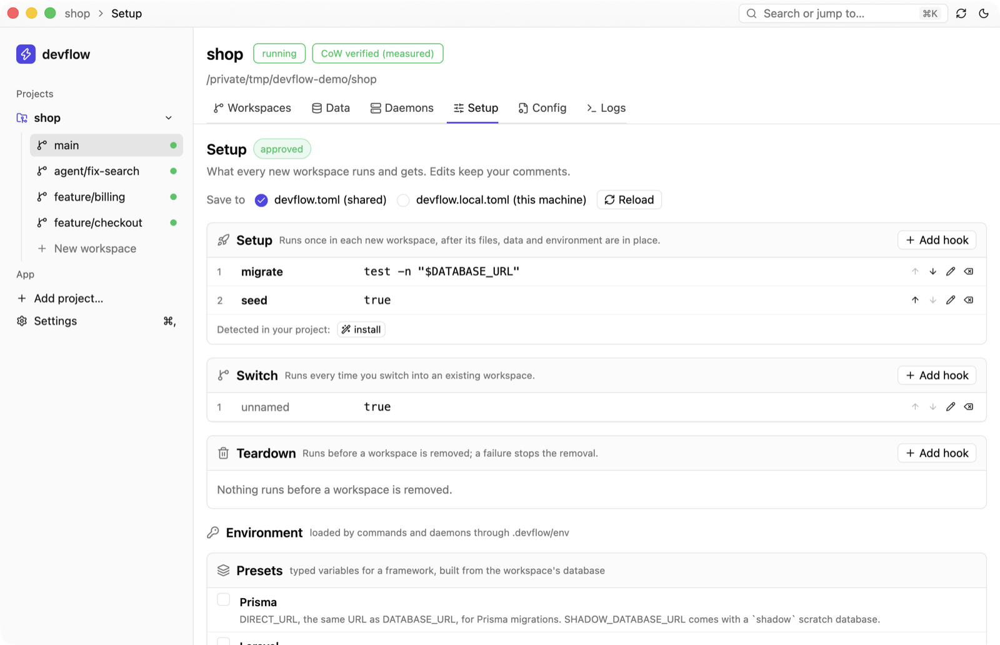

<p align="center">
  
</p>

<h1 align="center">devflow</h1>

<p align="center">Git worktrees with their own database, created in seconds.</p>

<p align="center">
  <a href="AGENTS.md">Agent guide</a> ·
  <a href="docs/MIGRATING.md">Migrating from 0.x</a> ·
  <a href="docs/REMOTE.md">Remote data hosts</a> ·
  <a href="docs/ARCHITECTURE.md">Architecture</a> ·
  <a href="CHANGELOG.md">Changelog</a>
</p>

<p align="center">
  
</p>

## What it does

devflow prepares an isolated development environment for each branch of a Git repository. It does four things, plus a desktop app:

1. **Worktrees.** Create, list and remove Git worktrees. Removal always refuses the default workspace and the one you are standing in. Dirty or locked worktrees need `--force`.
2. **Copy-on-write payloads.** Clone the ignored paths you list (`node_modules`, `.env`, build output) from the source worktree with APFS `clonefile` or Linux `FICLONE`. If the filesystem cannot share blocks, devflow copies.
3. **Postgres branches.** One PostgreSQL 18 server per project. Each workspace gets its own database, created with `CREATE DATABASE … TEMPLATE … STRATEGY FILE_COPY` and `file_copy_method = clone`, so on a reflink filesystem the new database shares blocks with its source.
4. **Hooks and environment.** Trusted shell commands with `DATABASE_URL` in the environment: `setup` runs once in a new worktree, `switch` on every `devflow switch` into an existing ready workspace (and once after `switch -c` reaches ready), `teardown` before removal. An `[env]` section adds variables to the generated `.devflow/env`, such as `DIRECT_URL`, framework presets (Prisma, Laravel, Spring, SQLAlchemy) and `COMPOSE_PROJECT_NAME`.

`devflow-gui` is a native desktop app (GPUI) over the same core: projects, workspaces, data services (PostgreSQL and containers) with their branches and snapshots, processes, setup logs and config editing.

## Why so little

The [jdx](https://github.com/jdx) tools now cover the rest, so devflow no longer builds it:

| Need | Use |
| --- | --- |
| Run dev servers, workers and schedulers; HTTPS names like `api.feature-x.shop.localhost` | [pitchfork](https://pitchfork.jdx.dev) daemons and its proxy |
| Install toolchains and dependencies, run tasks | [mise](https://mise.jdx.dev): `mise install`, `mise deps`, `mise run` |
| Share Rust build caches between checkouts | [Mr. Boxington](https://mr-boxington.jdx.dev) (`mbx`) |

None of them creates a worktree, prepares it, or branches database data. devflow does that and writes `.devflow/env` so those tools can pick up the result.

## Install

devflow embeds libgit2, so the `git` binary is not required. Managed Postgres needs Docker (or a compatible engine such as OrbStack); external mode needs a PostgreSQL 18 server instead.

```sh
# CLI release binary (Linux x86_64/arm64, macOS Apple Silicon) -> ~/.local/bin
curl -fsSL https://raw.githubusercontent.com/clement-tourriere/devflow/main/scripts/install.sh | sh

# or from source
git clone https://github.com/clement-tourriere/devflow.git && cd devflow
cargo install --path .

# desktop app (macOS 15+; not part of the release binaries)
cargo build --release -p devflow-gui        # target/release/devflow-gui
```

`devflow gui` starts the app; `devflow-gui` must be next to the `devflow` binary or on `PATH`. Linux needs Wayland or X11 with Vulkan for the GUI and is not yet advertised as supported. Set `DEVFLOW_INSTALL_DIR` or `DEVFLOW_VERSION` to change the installer's target or pin a release.

Optional shell integration, so `devflow switch` changes your directory:

```sh
eval "$(devflow shell-init zsh)"     # or bash, fish
```

## Quick start

```sh
cd ~/code/shop                        # any Git repository
devflow init                          # proposes a setup from what the repository contains, you review it, then it writes devflow.toml
devflow db up                         # start the project's PostgreSQL 18 container
devflow trust                         # review and approve what the project runs: hooks, [env], pitchfork processes
devflow switch -c feature/x           # worktree + payload + database branch + .devflow/env + setup hooks
devflow list                          # workspaces, status, database, path
devflow up                            # start the workspace's pitchfork daemons (approved, ready workspaces only)
devflow ps                            # daemon, state, port, URL
devflow remove feature/x              # stops its daemons, teardown hooks, drops the branch's database, removes the worktree
```

<p align="center">
  
</p>

`devflow switch -c` prints the new worktree path (`devflow path feature/x` prints it again). The directory is the sanitized workspace name (`feature/x` becomes `feature-x`), so use the printed path rather than building it. The generated `.devflow/env` holds `DATABASE_URL`, the `PG*` variables and `DEVFLOW_*` identifiers. The directory ignores itself, so it never shows up in `git status`.

A minimal `devflow.toml` (see [`examples/`](examples) for complete ones):

```toml
[project]
name = "shop"
id = "0b3c9d2e-…"                # written by `devflow init`

[worktree]
dir = "../{project}.worktrees"   # relative to the main checkout; absolute and ~/ paths work too
copy = [".env", "node_modules"]  # cloned from the source worktree; omit to copy nothing (init proposes the ignored paths it finds)

[services.db]                    # a service is a table named by its key, selected by its engine
engine = "postgres"              # postgres is the only engine so far
mode = "managed"                 # or "external"
image = "postgres:18"

[hooks]
setup = [
  "mise install",
  "mise exec -- devflow exec -- bun install",
  { name = "migrate", run = "mise exec -- devflow exec -- bun run db:migrate", timeout = "5m" },
]
teardown = []

[env]
DIRECT_URL = "${DATABASE_URL}"   # a recipe: devflow-generated variables, referenced once
presets = ["spring"]             # or typed fields: prisma, laravel, spring, sqlalchemy, db_parts
                                 # (a preset owns its variables: prisma sets DIRECT_URL, so use the recipe above or that preset, not both)
```

Machine-local overrides (an admin URL, a declared `cow`) go in `devflow.local.toml` beside it. It overlays every section, `[hooks]` and `[env]` included (tables merge, lists are replaced), and approval covers the merged result. It can hold an admin password, so keep it out of Git: `devflow init` does not edit `.gitignore` (this repository's `.gitignore` lists it; add it to yours).

### `devflow init`: a proposed setup

`devflow init` looks at the repository and proposes the configuration instead of writing a fixed template. The scan is read-only: it parses manifests, lockfiles, the compose file, `.env*` variable *names* (never their values), `Procfile`s, mise and pitchfork files, and which expensive directories Git ignores. It never runs project code.

The proposal is a list of items, each with a stable id, a confidence (`high`, `medium`, `low`), the evidence behind it, the risks, and what it depends on:

| Items | Examples |
| --- | --- |
| `[worktree] copy` | `copy:node_modules`, `copy:.env`, `copy:config/master.key` (never `.venv`, `.next`, `target`, `tmp`, `log`) |
| `[services.db]` | `service:db`: PostgreSQL 18 managed by devflow, from a compose `postgres`, `postgis`, `pgvector` or `timescaledb` image, or from a driver or ORM plus `DATABASE_URL`-style variables; risks when compose runs an older major version or mounts init scripts |
| `[services.<key>]` (Valkey, Redis, MySQL) | `service:<key>` for a compose service whose image is `valkey/valkey`, `redis` (or `docker.io/library/…`, Bitnami's, a tag that says `valkey` or `redis`) or `mysql:8.4*`: `engine = "valkey" \| "redis" \| "mysql"` with the compose image when devflow's profile can run it (Redis 7+, Valkey 7.2+, the official MySQL 8.4 image) and its own default otherwise, with the reason in `risks`. The URL variable is the one your `.env*` files or compose services use (`REDIS_URL`, `VALKEY_URL`, `CACHE_URL`; MySQL: `DATABASE_URL`, or `MYSQL_URL` beside PostgreSQL); a second cache gets its own (`QUEUE_URL`). Valkey and Redis are recommended and applied by default; **MySQL is a preview and is offered unticked** (`--accept service:mysql`). Not proposed: a project that already configures that service (no duplicate), more than one MySQL service, MySQL other than 8.4 (unsupported), images with modules (`redis-stack`, `valkey-bundle`: *not proposed automatically*) and Redis cluster or sentinel (unsupported). Each is said in the plan's `warnings` with the reason and a pointer to the manual configuration ([Valkey and Redis branches](#valkey-and-redis-branches), [MySQL branches](#mysql-branches-preview)) |
| `[hooks]` | `mise install` first (when mise pins tools; never `mise trust`: see below), then `hook:setup:install` (the idempotent install for the detected package manager, never `npm ci`), `hook:setup:codegen` (`prisma generate`), `hook:setup:migrate` (Prisma, Django, Rails, Alembic, Laravel, Ecto, sqlx, diesel, goose, dbmate, Atlas; an existing `db:migrate` script or mise task is preferred), and `docker compose up -d --wait …` / `down -v` hooks for the compose services devflow does not branch (MongoDB, MariaDB, MySQL other than 8.4, an image with Redis modules, …; PostgreSQL, Valkey, Redis and MySQL 8.4 are services instead). A compose container devflow branches can stay in the compose file for other uses, but the application must use the URL devflow exports. Branching or compose is decided when you select: a service whose `service:<key>` you leave unticked (MySQL always starts that way) or `--reject` is started by the compose hooks you accept, and a hook with nothing left to start is not written (a project whose only datastore is a cache lists the compose hooks as the alternative to `service:cache`) |
| `[env]` | `env:preset:prisma`, `laravel`, `spring`, `sqlalchemy`, `db_parts` |
| `pitchfork.toml` | `daemon:web`, `daemon:worker`: dev servers from `package.json` scripts, `bin/dev`, `runserver`, as `run = "devflow exec -- CMD"` (with `mise = true` when the repository uses mise), with `port = { expect = [N], bump = true }` and `$PORT` wired where the framework allows |
| `[pitchfork]` | `pitchfork:autostart` (medium confidence, so off unless accepted): start the daemons when a workspace is ready; offered when `pitchfork.toml` exists or daemons are proposed |
| `mise.toml` | `mise:env-file`: `[env] _.file = ".devflow/env"`, so shells and editors in the worktree see the workspace's own database (commands devflow runs do not need it: they go through `devflow exec`) |

```sh
devflow init                                  # show the plan, ask (all high-confidence items at once, then medium and low), write
devflow init --plan                           # show the plan and write nothing
devflow --json init --plan > plan.json        # the proposal as one JSON document: review it, keep it
devflow init --apply plan.json                # apply its high-confidence items
devflow init --apply plan.json --accept hook:setup:compose-up --reject daemon:web
devflow init --yes                            # plan + high-confidence items + write, without asking
devflow init --name shop --postgres external  # --postgres managed|external|none overrides the proposal
```

Existing files are preserved: patches only add, keep the formatting and comments of what is there, and recognize what is already configured. A key that exists with a different value (a `mise.toml` with another `_.file`, an `[env]` recipe that sets `DIRECT_URL` by hand, a hook named `migrate` that runs something else) is reported as a conflict with the reason and never overwritten; an item with a conflict cannot be applied. `--apply` first checks that the files the plan read have not changed since (it names the ones that did), records the hashes it intends to write in an apply journal under the repository's `.git/devflow/`, and writes atomically: a file saved by someone else while `--apply` replaces it is not overwritten (the replacement is exchanged with the file and what was displaced is compared; a save that cannot be put back is kept as `NAME.devflow-conflict-<timestamp>` and named in the error). That guarantee needs an atomic exchange, which APFS and Linux filesystems with `RENAME_EXCHANGE` have; elsewhere a narrow window between the last check and the rename remains and only a hard-link backup of the displaced file is kept. If it is interrupted, running it again with the same plan and the same `--accept`/`--reject` continues; running it after it finished does nothing. **Writing configuration never installs tools, trusts hooks or runs a command**: review the files, commit them, then `devflow trust` shows everything one approval covers.

### Hooks

`setup`, `switch` and `teardown` are lists of shell commands, run with `sh -c` in the worktree with `.devflow/env` applied. Each entry is a string, or a table when it needs a name or its own timeout:

```toml
[hooks]
timeout = "15m"                                   # the default, per command
setup = [
  "bun install",                                  # a plain command
  { name = "migrate", run = "bun run db:migrate", timeout = "5m" },
]
```

A name (1 to 64 characters, unique within its phase) is shown in the output, the setup log and failures: `[migrate] $ bun run db:migrate`. A `timeout` overrides `[hooks] timeout` for that command. Hooks run in order, stop at the first failure, run at least once (write them to be idempotent), and are never templated.

Edit them without opening the file. The commands keep your comments and order, validate the result before writing it, and refuse to overwrite a file that changed meanwhile:

```sh
devflow hooks list                                        # each phase, with positions
devflow hooks add setup 'bunx prisma migrate deploy' --name migrate --timeout 5m --after 1
devflow hooks update setup migrate --timeout 10m
devflow hooks move setup migrate first                    # a position from 1, first or last
devflow hooks remove setup 2                              # a name or a position
devflow hooks add setup 'make seed' --local               # this machine only: devflow.local.toml
```

A list in `devflow.local.toml` replaces the committed one whole, so the first `--local` edit of a phase starts from a copy of the committed commands and says so. Changing a command changes what an approval covers: the command prints that the new configuration needs review and points to `devflow trust`; it never approves anything itself. The desktop app's Setup tab does the same with forms.

### Environment (`[env]`)

`.devflow/env` holds what devflow generates (`DATABASE_URL`, the `PG*` variables, `DEVFLOW_*`, `COMPOSE_PROJECT_NAME=df-<project8>-<instance8>`, a Compose project name unique to the workspace, and `<NAME>_DATABASE_URL` for each of the service's `extra_databases`). `[env]` adds your own variables, written to the same file and passed to hooks:

```toml
[env]
presets = ["prisma", "spring"]
DIRECT_URL_FOR_TOOLS = "${DATABASE_URL}"
DB_HOST_ALIAS = "${PGHOST}"
API_ORIGIN = "http://localhost:3000"
```

- A value may reference devflow-generated variables as `${NAME}`: `DATABASE_URL`, the `PG*` variables, `DEVFLOW_*`, `COMPOSE_PROJECT_NAME` and the `<NAME>_DATABASE_URL` of your `extra_databases`. One pass only: no defaults (`${A:-b}`), no nesting, and never another recipe. Write `$${` for a literal `${`.
- Configuration is refused, naming the key, for an invalid name (`^[A-Za-z_][A-Za-z0-9_]*$`), a variable devflow generates or reserves (`DEVFLOW_*`, `PG*`, `DATABASE_URL`, `COMPOSE_PROJECT_NAME`, `TEST_DATABASE_URL`, `SHADOW_DATABASE_URL` and the `<NAME>_DATABASE_URL` of each of your `extra_databases`), a reference to anything else, and a conflict between recipes and presets.
- Presets render typed fields from the database's connection parameters, percent-encoded where they are URLs: `prisma` sets `DIRECT_URL`; `laravel` sets `DB_CONNECTION`, `DB_HOST`, `DB_PORT`, `DB_DATABASE`, `DB_USERNAME`, `DB_PASSWORD`; `spring` sets `SPRING_DATASOURCE_URL` (JDBC), `_USERNAME`, `_PASSWORD`; `sqlalchemy` sets `SQLALCHEMY_DATABASE_URI` (`postgresql+psycopg://`); `db_parts` sets `DB_HOST`, `DB_PORT`, `DB_NAME`, `DB_USER`, `DB_PASSWORD`. A workspace without a database (`--no-db`) skips the presets and any recipe that needs a database variable, with a warning.
- `preset = "prisma"` (or `presets_`, `Presets`) is not the `presets` list: it sets a variable named `preset`. devflow accepts it, since it is a valid recipe, and warns in `devflow env list` and `devflow doctor`: `did you mean presets = ["prisma"]?`.
- A value built from the database password is secret: it is written only to `.devflow/env` (mode 0600), never printed, and masked whole in hook output and logs.
- Recipes and presets are applied only for an approved scope (next section); until then `.devflow/env` holds what devflow generates and the workspace is `needs_attention`.

`devflow env list` shows the recipes, the presets and what they resolve to in a workspace (credentials masked, including a literal under a name like `APP_PASSWORD`; `--show-values` prints them); `devflow env set NAME '${DATABASE_URL}'`, `devflow env unset NAME` and `devflow env preset add|remove NAME` edit them like `hooks` does, and `--local` writes `devflow.local.toml`, the only place a literal credential is accepted.

### What `devflow trust` approves

One approval covers a versioned scope: every hook command (with its name and timeout), the `[env]` recipes and presets as written (the templates, never generated values), and the pitchfork configuration of the project directory (`pitchfork.toml`, `.config/pitchfork.toml` and their `.local.toml` overlays: every daemon's command, `dir`, `env`, hooks, `cron`, `watch`, `boot_start`, `auto`, `depends` and `ready_*`). `devflow trust` prints all of it and flags the daemons pitchfork can start without devflow (`cron`, `watch`, `boot_start`, `auto`). Any change to any part needs a new approval, and an approval made by an earlier devflow (hooks only) is reported as an older format and does not apply. A project with none of these has nothing to approve. The review masks a credential-named `[env]` variable like `env list` does (`DB_PASS = ***`), in the terminal, in `--json` and in the desktop app; the approval is of the real content.

### Database branches

A new workspace's database is a clone of the database of the workspace its code comes from (`--from`, else the default workspace), unless you pass `--data-from WS|snapshot:NAME[@vN]|branch:ID|empty`. A branch `ID` is a UUID or any unique prefix of at least 8 hex characters, with or without dashes, so the short ids `db branch list` and `service list` show work in `--data-from branch:ID`, `--to branch:ID`, `db branch delete ID` and `service NAME drop ID`; an unknown or ambiguous prefix is an error that names the candidates. The default workspace's database is created empty the first time something needs it: `switch -c` (which warns about it) or `devflow setup` in the main checkout.

Cloning needs the source database to have no open sessions. For a managed server bound to loopback, `on_busy_source` defaults to `disconnect`: creating a workspace from a live workspace terminates the open sessions of the source database. For external or non-loopback servers the default is `fail` and the clone is refused. Set `on_busy_source` under `[services.db]` to choose.

#### Test and shadow databases (`extra_databases`)

Branch logins cannot create databases (they keep `NOCREATEDB`), but Django's test runner, Prisma Migrate and Rails want one. List the names you need and every branch gets its own **scratch databases**:

```toml
[services.db]
engine = "postgres"
extra_databases = ["test", "shadow"]   # ^[a-z][a-z0-9_]{0,20}$, unique; not main, postgres, devflow or template*
```

- Each is exported as `<NAME>_DATABASE_URL` (`TEST_DATABASE_URL`, `SHADOW_DATABASE_URL`) in `.devflow/env` and to hooks, with the branch's own login and password, and masked like `DATABASE_URL`. `[env]` recipes can reference them (`${TEST_DATABASE_URL}`) but not set them; the `prisma` preset needs nothing more, because `SHADOW_DATABASE_URL` is already there for `shadowDatabaseUrl = env("SHADOW_DATABASE_URL")`.
- They are created empty, with the same closed-creation protocol as the branch's database, and named by devflow (`df_<project8>_<branch12>_<n>`), never from the label. A workspace cloned from another (or from a snapshot) gets its own empty ones; they are never copied and never part of a snapshot.
- `devflow db reset` empties them again: it drops and recreates each one, recorded step by step, so an interrupted reset is finished by `devflow db reconcile`. Credential rotation covers them (one login), and removing the workspace drops them with its branch (`--keep-data` keeps them).
- A name added to `devflow.toml` is provisioned for existing workspaces by the next `devflow setup` or `switch` (they read as `needs_attention` until then). A name removed stays on the server as a recorded **orphan**: its data is kept, it is not exported, `devflow db reconcile` and `devflow doctor` report it, and `devflow db reconcile --drop-orphans` drops it.
- A workspace attached to a database URL (`setup --database-url`) has no branch to add to: it gets no scratch databases, and a warning says so.

`devflow db branch list` shows them (`EXTRAS` column; `--json` has `extras` with names and databases, never passwords) and `devflow --json list` shows them in each receipt binding.

A project has at most one `postgres` service; `devflow db …` addresses it whatever its key. A workspace's receipt records each service's binding under `receipt.services.<key>` together with the configuration it was applied under: add a service or change its section in `devflow.toml` and every existing workspace becomes `needs_attention` (services, env and hooks are reopened; `--no-db` and `--no-hooks` skips are kept) until `devflow setup` or the next `switch` completes them. Removing a service never deletes its data.

A managed server's host port is fixed. With the default `port = 0`, devflow picks one from the project and service identity in 20000–39999 the first time the server starts, records it in the server's `admin.json` and publishes it on `127.0.0.1` from then on, so URLs survive restarts. If something else holds the recorded port later, `devflow db up` fails and names the port and the cause; it never moves it (set `port` yourself to choose another). On OrbStack the server is also reachable from other containers at `db.<project>-<id8>.devflow.orb.local:5432` (shown by `devflow db status` as `container_endpoint`); `DATABASE_URL` keeps using `127.0.0.1`.

### Valkey and Redis branches

A `valkey` or `redis` service gives each workspace a cache or queue of its own, cloned from its source's data the way the database is:

```toml
[services.cache]
engine = "valkey"                 # valkey | redis; managed only (devflow runs the containers)
# image = "valkey/valkey:8-alpine"   # default per engine (redis: "redis:8-alpine"); pinned per branch by digest
# env = "REDIS_URL"               # the variable the URL is exported as; two services cannot share one
# require_cow = false             # true: refuse a clone unless the volumes share blocks
```

- **Per workspace.** `switch -c`, `setup` and `switch` give the workspace a container of its own on a fixed `127.0.0.1` port, with its own generated password, and export `redis://:<password>@127.0.0.1:<port>/0` as `REDIS_URL` (or your `env`) in `.devflow/env` and to hooks. The URL is a secret: masked in output and logs, in a 0600 file, usable as `${REDIS_URL}` in `[env]` recipes. `--data-from` works as for the database (`WS`, `snapshot:NAME[@vN]`, `branch:ID`, `empty`) and is pinned per service; a source the service does not have fails that service and is never replaced by an empty one.
- **How a clone works.** devflow runs Valkey/Redis with AOF off, RDB on and a `save` policy (`--appendonly no --save "3600 1 300 100 60 10000" --dir /data`). A clone first has the source write a complete dump: `BGSAVE`, then wait until `INFO persistence` shows no save running, `rdb_last_bgsave_status:ok`, an advanced `rdb_saves` and the same `run_id` (`LASTSAVE` is not enough: it has one-second resolution). The source is never paused or stopped and keeps serving writes. The completed `dump.rdb` is reflinked into the new volume inside the Docker VM by a helper container running GNU `cp -a --reflink=always` (never `--reflink=auto`), under a deadline, and the clone starts with its own new `--requirepass`. An RDB carries data, not credentials, so that password is the whole identity fix-up and it is on the command line the container starts with, before the server listens. It is then checked with `AUTH` and `PING` before it counts as ready. A clone is the dataset at the instant of the `BGSAVE` fork, reported as its capture time; writes after it belong to the source alone.
- **A source with nothing new to save is not saved again.** Before the `BGSAVE`, devflow reads `INFO persistence`. When `rdb_changes_since_last_save` is 0, no save is running, `rdb_last_bgsave_status` is `ok` and the source's volume holds a `dump.rdb`, that file is reflinked as it is and no save is asked for; any other case takes the `BGSAVE` path above. This is sound because the server writes an RDB to a temporary file and renames it over `dump.rdb`, so the file is always a complete one and the reflink sees one whole version, and because with no change since the last save that file is the live dataset. A write that races the check is in the same position as one racing a `BGSAVE` (the clone has it or not, and the capture time says which instant). It matters for space: a fresh `BGSAVE` writes a new file while the previous one stays shared with the volumes of earlier clones, which measured about one more dataset (+115 MiB for a 128 MiB one) in the Docker VM per clone. Such a clone records `capture_last_save` (shown as `(last save)` in `service list`) and takes as its capture time the server's `rdb_last_save_time`.
- **No reflink, no surprise.** If the volume storage refuses reflinks, `require_cow = true` aborts the clone; otherwise a full copy is made and reported as `copy`. The decision is journaled before the source is touched. `devflow service status` and `devflow doctor` report the capability per Docker daemon (`verified`, `copy` or `unknown`) from a measured probe (a 64 MiB file reflinked in a scratch volume, free space compared before and after, cached).
- **Snapshots and reset.** `devflow service [NAME] snapshot create NAME` writes a `BGSAVE` and reflinks `dump.rdb` into a new immutable volume (no container); `--data-from snapshot:NAME[@vN]` clones from it. `service reset` stages a replacement volume from the branch's recorded source (or `--to SRC`), starts it on its own and checks it, then swaps it in under a journal: the URL (port and password) does not change, and the original pair is kept until the replacement is validated, then removed.
- **Ports and names.** Each branch's port is allocated once from `hash(project, service, branch)` in 20000–39999, journaled before Docker publishes it, decided by the bind, and kept: if something else holds it later, `service up` or `switch` reports the port and the cause and never moves it. On OrbStack the container also gets the name `<branch8>.<key>.<project>-<project8>.devflow.orb.local` (port 6379) for apps in containers on the same Docker networks, shown as `container_endpoint`; the exported URL stays on `127.0.0.1`.
- **Ownership comes from the catalog, not from names.** `<data dir>/services/<project id>.json` (0600, versioned, bound to the Docker daemon id) records each branch's container id and name, volume, pinned image digest, port, source, capture time and clone method, and the operation journal. Docker labels only corroborate it before devflow touches a resource, and a container that merely has a devflow name is refused. Dropping a workspace removes its branch by recorded identity (`--keep-data` keeps it); removing a service from `devflow.toml` keeps its data, which `devflow service list --orphans` and `reconcile` report and `devflow service NAME forget` removes.
- **Crashes.** A clone, snapshot or reset runs in its own process (`devflow __clone`, hidden), which holds the source's lock until it ends. If it dies, its helper may live on in the VM, so every later operation on that source or destination first reconciles the unfinished journal entries under the same lock: it kills the recorded helper, confirms it is gone and aborts the destination (never promoting it). `devflow service reconcile` does the same on request.
- **Limits.** Containers start on `setup`, `switch` and `devflow service up`, not when something connects, and they do not restart by themselves after a Docker restart. One machine controls a Docker daemon. AOF-enabled servers and ACL files are refused. Other engines are not part of this release (MySQL is a preview, below).

`devflow service [NAME] status|up|down|url|list|snapshot create|list|delete|reset|reconcile|drop|forget` manages them (`NAME` may be left out when the project has one container service). `devflow service NAME url` is the one `service` command that prints the password.

### MySQL branches (preview)

> **Preview.** The MySQL engine passes its Docker release gate (`cargo test -p devflow --test services_mysql_docker -- --ignored --test-threads=1`) on OrbStack, but it has not been through an independent review yet; treat it as a preview until that review closes. Unlike Valkey and Redis, cloning a MySQL source **interrupts the source for a few seconds**.

A `mysql` service gives each workspace a MySQL 8.4 server of its own (standalone InnoDB), cloned from its source's data copy-on-write:

```toml
[services.sql]
engine = "mysql"                  # MySQL 8.4, standalone InnoDB; managed only (devflow runs the containers)
# image = "mysql:8.4"             # pinned per branch by digest; 8.4 is the only profile
# database = "shop"               # the database every branch has; default: the project name as an identifier
# env = "MYSQL_URL"               # the variable the URL is exported as; default DATABASE_URL, or MYSQL_URL beside a postgres service
# require_cow = false             # true: refuse a clone unless the volumes share blocks
```

- **Variables.** `switch -c`, `setup` and `switch` give the workspace a container of its own on a fixed `127.0.0.1` port and export `mysql://app:<password>@127.0.0.1:<port>/<database>` as `DATABASE_URL` (or your `env`; `MYSQL_URL` when the project also has a `postgres` service, which keeps `DATABASE_URL`; a collision is a configuration error naming both services), together with `MYSQL_HOST`, `MYSQL_PORT`, `MYSQL_USER`, `MYSQL_PASSWORD` and `MYSQL_DATABASE`. They are in `.devflow/env` (0600) and visible to hooks; `[env]` recipes may read them (`${MYSQL_HOST}`) and cannot set them. The URL and the password are secrets, masked like `DATABASE_URL`. A project has at most one `mysql` service for now (the typed fields have no prefix). `--data-from` works as for the other services (`WS`, `snapshot:NAME[@vN]`, `branch:ID`, `empty`) and is pinned per service.
- **The server.** devflow generates the `my.cnf` and mounts it read-only (`<data dir>/services/mysql-profile-v1.cnf`): no binary log, no replication, no X plugin, `performance_schema` off, a 64 MiB buffer pool, durability at MySQL's defaults, `innodb_fast_shutdown=0`, and **InnoDB only**: `default_storage_engine=InnoDB` and `disabled_storage_engines` listing MyISAM, MEMORY, BLACKHOLE, ARCHIVE, CSV, FEDERATED and MERGE, so a table cannot be created with, or altered to, one of them. An idle branch uses about 125 MiB of memory (`docker stats`; `mysqld` RSS about 155 MiB). Each branch has a `root@localhost` (only reachable inside the container) and an `app@%` account (all privileges on its one database), both with generated passwords of their own, kept in the 0600 catalog and never printed except by `devflow service NAME url`.
- **How a clone works.** The coordinator (`devflow __clone`) holds the source's lock and journals each step. It stops the source with `docker stop` and a generous timeout, then **proves the shutdown was clean**: exit code 0 and InnoDB's own shutdown report in the container's log since its last start. A stop that ended in `SIGKILL` aborts the clone and the source is started again; so does one that was a crash-style shutdown (`innodb_fast_shutdown=2` exits 0 too): right before the stop devflow sets `innodb_fast_shutdown=0` as root (resetting a `SET PERSIST` of it) and reads it back, the log must have no very-fast-shutdown notice, and neither the source's next start nor the clone's first start may log InnoDB crash recovery. The whole data directory is then reflinked into the new volume inside the Docker VM (`cp -a --reflink=always`, never `auto`, source read-only, no network), without `auto.cnf` and the TLS and RSA key pairs; the source is started and checked again (`Restoring`), and its downtime is recorded. The clone starts first with no network at all (`--network none`, no grant tables), and through its local socket (`docker exec`, passwords on standard input) the version is checked, the accounts audited, new passwords set and both logins proven. Only then is it stopped cleanly and recreated with its published port, and checked with an authenticated `SELECT 1` as `app` and the MySQL greeting on that port.
- **A source must be devflow's.** A data directory with any account besides MySQL's own, `root@localhost` and `app@%` (`mysql.user` is audited, roles included) is refused with the accounts named, because they would keep their source's password in the clone. Drop them in the source (`DROP USER`) and clone again. Role grants and proxy privileges (beyond `root@localhost`'s default one) are refused the same way. Nothing of the source's authentication is inherited: both passwords are new, a *secondary* password a source kept with `RETAIN CURRENT PASSWORD` is discarded, the plugin, TLS requirement, expiry and lock-out are put back to `caching_sha2_password` with none of the others, and the accounts are read back before the clone is accepted.
- **What the source feels.** Its connections are closed, running statements are cancelled (a long `ALTER TABLE` ends with "Server shutdown in progress" and is rolled back) and clients must reconnect. Everything committed before the stop is in the clone and in the source; the clone is exactly the data directory of a server that shut down cleanly, with no crash recovery. A coordinator that dies leaves the source stopped until the next operation on it, which starts it again, kills the recorded helper and aborts the destination (`devflow service reconcile` does it on request). `devflow service status`, `devflow doctor` and the setup output report the downtime of the last clone.
- **Snapshots and reset.** `service snapshot create NAME` stops the source cleanly, reflinks its data directory into an immutable volume and starts it again (no container for the snapshot; `--data-from snapshot:NAME[@vN]` clones from it with no source to stop). `service reset` stages a replacement volume, bootstraps it with the branch's own credentials (so the URL does not change) and swaps it in under the journal, keeping the original until the replacement is validated; reset data must carry the same database the branch's URL names. Drop removes the branch's container and volume by recorded identity.
- **Limits.** **InnoDB tables only; MEMORY tables are not supported**: a clone stops the source, a MEMORY table loses its rows when the server stops, so a running source that has any table outside InnoDB (other than in MySQL's own schemas; views do not count) is refused before anything is stopped, naming the tables (`ALTER TABLE … ENGINE=InnoDB` or drop them). **The source is unavailable for the length of a clone or snapshot** (a few seconds on a small dataset, longer on a large one, reported as the downtime), and a statement running at that moment is cancelled. One MySQL version (8.4) and one mysql service per project; no replication, binary log, init scripts or time zone tables; a Docker daemon that can mount devflow's data directory (the profile file); containers start on `setup`, `switch` and `devflow service up`, not when something connects. MariaDB and other engines are not part of this release.

### Commands

| Command | Purpose |
| --- | --- |
| `hooks list\|add\|update\|remove\|move`, `env list\|set\|unset\|preset add\|remove` | List and edit the `[hooks]` commands and the `[env]` recipes and presets in `devflow.toml` (or `devflow.local.toml` with `--local`), keeping comments and refusing stale writes (`--if-unchanged SHA256`) |
| `init`, `trust`, `hook install\|uninstall` | Propose and write the config (`--plan`, `--apply PLAN.json`, `--yes`, `--accept`/`--reject ID`, `--name`, `--postgres managed\|external\|none`; `--hook` also installs the Git hook), review and approve what the project runs (`-y` skips the question), install the post-checkout hook |
| `switch [-c] NAME`, `list [--all]`, `path NAME` | Create, enter and inspect workspaces; `--all` lists every registered project |
| `remove NAME` | Delete a workspace; `--keep-data` keeps its database branch, `--delete-branch` also deletes the Git branch, `--force` overrides dirty, locked and failing-teardown protections |
| `exec [--workspace NAME] -- CMD [ARGS…]` | Run a command with the workspace's `.devflow/env` applied last (over whatever mise set); see "Commands that need the workspace's database go through `devflow exec`" |
| `setup` | Run the same pipeline in an existing worktree (adopt, resume, fork); `--skip-mise-check` (also on `switch`) runs the setup hooks without the mise checks below |
| `db status\|up\|down\|url\|psql\|reset\|reconcile` | Manage the server and a workspace's database; `db reconcile --drop-orphans` also drops scratch databases the configuration no longer lists |
| `db snapshot create\|list\|delete`, `db branch list\|create\|delete` | Reusable seed data and explicit branch control |
| `service [NAME] status\|up\|down\|url\|list\|snapshot create\|list\|delete\|reset\|reconcile\|drop\|forget` | Valkey, Redis and MySQL (preview) branches: containers, snapshots, staged reset, crash recovery (`list --orphans` finds data nothing uses) |
| `doctor`, `shell-init`, `completions SHELL`, `gui` | Diagnostics, shell integration, shell completions, desktop app |

All inspection and mutation commands accept `--json`; `db psql`, `shell-init`, `completions` and `gui` do not. Run `devflow --help` for flags.

## Desktop app

`devflow gui` (or `devflow-gui --project PATH`) opens the same operations in a window: create, set up and remove workspaces, review and approve what the project runs, follow each phase, start and stop the managed server, manage snapshots, and edit `devflow.toml`.

<p align="center">
  
</p>

Code and data origins are chosen separately, as with `--from` and `--data-from`.

<p align="center">
  
</p>

The PostgreSQL page of the Data tab shows the server, whether clones share blocks (measured on this machine), every branch with its source, and the snapshots.

The Data tab (⌘2) lists every data service of the project as a card: PostgreSQL first, then each container service (Valkey, Redis, MySQL, whatever core supports; the app never branches on the engine). A container service's page shows its image, the Docker engine it is bound to, and whether clones share blocks (`verified`, `copy` or `unknown`, read from the cache; **Measure** runs the probe on request). Each branch lists its owner workspace (from the receipt's instance id, never from a name), state, endpoints, source, capture time and last clone, including how long a MySQL source was stopped for the copy. **Copy URL** shows the URL masked on screen and puts the full URL on the clipboard. Start, stop, snapshot, delete a snapshot, reset (after a confirmation that says what is lost), reconcile, and dropping or forgetting orphans (also behind a confirmation) are background jobs with their progress and errors in the activity log; a long one also shows in the title bar.

<p align="center">
  
</p>

The Setup tab (⌘4) edits the hooks and `[env]` without opening a file: named rows that can be added, reordered, edited and removed, commands detected in the project offered with one click, and the framework presets. Edits keep the file's comments, go to `devflow.toml` or `devflow.local.toml`, and are approved before they run like any other change. A change made outside the app (`devflow env preset add`, an editor) shows up on the next refresh (⌘R) or when the window is activated again; while a form is open the tab keeps it and says the file changed, with a Reload button. ⌘⇧L switches between the light and dark themes (also the sun/moon button in the title bar).

The Workspaces tab opens on an overview of the project: workspaces by status, services and their branches, processes running, the disk copy-on-write saved (always an upper bound, "up to", from the apparent size of what was cloned; unread paths are marked incomplete) and the last activity, with **New workspace** as its one primary action. A selected workspace's detail lists its processes with the state, port and a clickable proxy URL, and Start, Stop and Restart gated by the same checks as the Daemons tab (including **Review and start…** when the approval must be renewed). When core refuses, the refusal is shown with its explanation: a `.devflow/env` mise does not deliver says so and offers **Run doctor**. Its Connections list shows container bindings beside PostgreSQL.

Pitchfork is offered in the setup wizard (when the plan involves processes) and in the Daemons tab: if it is missing, the install command is shown first and runs only on a click; the proxy's `sudo` commands are only ever copy buttons. The command palette (⌘K) adds entries that exist only when they apply: start, stop and restart processes, open a daemon's URL, snapshot or reset data, install pitchfork and run the doctor.

### Setting up from the app

A project with no `devflow.toml` opens on one button, **Set up devflow…** (also in the command palette and a project's context menu, where it adds what is still missing to a project that is set up already). It is the same plan-then-apply as `devflow init`, in six steps with Back and Next (Enter and the arrow keys work too):

1. **Detected**: what devflow found, as plain facts (languages, package managers, migration tools, compose services, mise and pitchfork files). Nothing ran and no `.env` value was read.
2. **Proposal**: the items core proposes, grouped, each with a checkbox at its default, a confidence, the reason and a detail you can open. Choose a managed PostgreSQL server, an existing one, or none.
3. **Review**: the exact lines added to each file, green and red, before anything is written.
4. **Apply**: core writes the files atomically and lists them. If the repository changed since the plan, nothing is written and you are offered to plan again.
5. **Approve**: the commands and `[env]` recipes an approval covers, and the button. Skipping leaves them unapproved.
6. **Done**: what to commit, and **Create your first workspace**.

Once a project is set up, the **Setup** tab (⌘4) keeps it that way without opening TOML: the three hook phases with what each is for, an add-hook form with hooks detected in your project as suggestions, reorder, edit and remove, the framework presets and the `[env]` variables with their resolved values masked (reveal on request), a switch between the shared `devflow.toml` and your own `devflow.local.toml`, and a banner when what the project runs needs your approval. Every save is a core edit: comments stay, an invalid value is refused under the form, and a file that changed on disk is never overwritten (*devflow.toml changed on disk — reload*).

Selecting a workspace in the Workspaces tab shows its detail below the table: the phases of its setup with how long each took, errors and **Retry setup**, its connections (host and container endpoints, passwords masked, copy and reveal) with its scratch databases, and what it costs in time and disk. Disk is reported as the file system reports it: for each payload path the apparent size (the sum of the file lengths) and the allocated size (blocks, with blocks shared with the source counted in full and directory metadata left out), marked incomplete when some entries could not be read; a cloned payload is never reported as costing zero.

## Copy-on-write, measured

Branch creation speed and disk cost depend on the filesystem under the PostgreSQL data directory. devflow measures instead of assuming and reports `verified`, `copy` or `unknown`.

Benchmark (OrbStack, btrfs volume, PostgreSQL 18): a 392 MB database cloned in **0.93 s** and used **+0.2 MB** on disk. The default `WAL_LOG` strategy used +370 MB on the same database. `FILE_COPY` forces a checkpoint, so latency also depends on server activity. Your numbers will differ.

| PostgreSQL data directory on | Result |
| --- | --- |
| Managed server on OrbStack (named volume on btrfs) | `verified` |
| Linux btrfs, XFS with reflink, or ZFS 2.2+ | `verified` |
| ext4 | `copy`: a full copy per branch |
| Docker Desktop, or a macOS bind mount (virtiofs) | `copy`: a full copy per branch |
| External server | `unknown`, unless you declare `cow = "verified"` in `devflow.local.toml` |

Valkey/Redis branches (OrbStack, Docker volumes on btrfs, `valkey/valkey:8-alpine`): a dataset of 32,000 keys of 4 KiB (about 128 MiB, incompressible) cloned in **2.4 s end to end** (coordinator start, `BGSAVE` of the source, reflink of `dump.rdb`, container create and start, `AUTH`/`PING`) and took **+32 KiB** in the Docker VM (guest `df` before and after, an estimate). The source answered every write during the clone (no pause). Your numbers will differ. A source with nothing new since its last save is cloned from that save, with no `BGSAVE`: otherwise each new save rewrites the whole RDB while earlier clones still share the old one, which cost a full RDB (about +115 MiB here) per clone of an unchanged source before this was added.

MySQL branches (same engine, `mysql:8.4`, 64 MiB buffer pool): a data directory of 436 MiB (a 236 MiB table of 200,000 rows of about 1 KiB, plus InnoDB's redo, undo and doublewrite files) cloned in **6.8 s end to end**, with the source **stopped for 3.0 s** (clean shutdown, reflink, start, first authenticated answer); the copy itself took **+164 KiB** in the Docker VM and the whole operation **+113 MiB** (guest `df` before and after: the new server's own files, such as its temporary tablespaces, and the pages a running server rewrites). A snapshot of the same directory took 3.3 s with the source stopped for 3.1 s. An empty, idle MySQL branch holds about 200 MiB of the VM's disk (the initialized data directory and a running server) and about 125 MiB of memory. Creating the empty root branch takes 7-13 s (initialization, bootstrap, first start). These were measured on a busy machine: under a load average of about 40 the same clone took 15-26 s with the source stopped for 9-15 s, so the downtime tracks the host's I/O, and it grows with the dirty pages InnoDB flushes at shutdown.

A whole workspace, end to end (`devflow switch -c`, release build, Apple silicon, OrbStack): a project with a 324 MiB `node_modules`-like payload of 20,000 files, a managed PostgreSQL 18 server holding a 231 MB table and a Valkey cache of 32,000 keys of 4 KiB, with one setup hook.

| `switch -c` | Time | Disk added |
| --- | --- | --- |
| Warm (source server and cache running) | **5.1–5.4 s** (payload 1.5 s, both data clones about 3.5 s, env and hooks under 30 ms) | **+0.3 MiB** in the Docker VM for the database and the cache; **+5.8 MiB** on APFS for the payload (file metadata; measured on a dedicated volume, since the system volume's free space moves by more than that on its own) |
| Cold (source containers stopped) | **10.1 s** (the server's start and health check included) | same |

The first clone after the cache was loaded also wrote its first save (+120 MiB): that is the source's own data reaching disk, not a cost of the clone. Your numbers will differ with the filesystem, the dataset and the hooks.

Worktree payloads are cloned with `clonefile` on APFS and `FICLONE` on btrfs, XFS with reflink and ZFS 2.2+; on other filesystems they are copied.

`devflow doctor` reports the capability it found and whether it was measured or declared. Set `require_cow = true` under `[services.db]` to refuse branch creation when CoW is not verified. Without CoW, branches still work; they take longer and use the full database size.

## Composing with pitchfork and mise

devflow's job ends at `.devflow/env`. Let mise load it for the shells and editors you use in the worktree:

```toml
# mise.toml
[tools]
bun = "1.2"

[env]
_.file = ".devflow/env"
```

Declare daemons in a committed `pitchfork.toml`. Run each command through `devflow exec`, which applies `.devflow/env` last, after mise (`mise = true`, for the toolchain) and anything else has set its own environment:

```toml
# pitchfork.toml
[daemons.api]
run = "devflow exec -- bun run dev"
mise = true
port = { expect = [3000], bump = true }
```

The daemon sees `DATABASE_URL` of the worktree it runs in, however mise is configured. devflow never puts the environment or a credential into a pitchfork file: pitchfork keeps daemon environments in its state file, so the file is read by `devflow exec` at the moment the command starts. `devflow` has to be on the `PATH` of the process that starts the daemons.

### Starting and stopping, with your approval

```sh
devflow pitchfork status              # installed? version, features, supervisor, proxy; what to run if not
devflow up                            # pitchfork start of this workspace's own daemons (by full id); shows what pitchfork reports afterwards
devflow ps [--all]                    # daemon, state, port, URL
devflow down                          # pitchfork stop of this workspace's running daemons (by full id)
```

- Each worktree gets a machine-local `pitchfork.local.toml` with only a unique `namespace` (`df-<project8>-<instance8>`) and a `worktree_label`, excluded through the repository's `info/exclude`, so daemons of different worktrees and repositories never collide. A `namespace` declared in the committed `pitchfork.toml` conflicts (pitchfork refuses disagreeing sibling files): devflow says so, writes nothing and will not start or stop through it.
- A workspace acts only through the namespace devflow assigned it. If its pitchfork files name another (say, another worktree's), `devflow up`, `down` and `remove` refuse ("the pitchfork namespace does not belong to this workspace"), `devflow ps` shows none of that namespace's daemons, and the edit drops the approval; `up` restores devflow's own file when it is merely stale.
- devflow starts and stops exactly the daemons of the workspace, by full `namespace/name` id, and never with `--local`: pitchfork's `--local` also selects the daemons of every parent directory's configuration. A daemon that `depends` on one outside the workspace's own files is refused, since pitchfork would start that one too.
- devflow starts daemons only for a `ready` workspace whose own `pitchfork.toml` is the one `devflow trust` approved, and never in bulk while a daemon starts on its own (`cron`, `watch`, `boot_start`, `auto`: a supervisor started anywhere in the repository would run those without devflow). Plain daemons can still be started by name, `devflow up --daemon api`. It stops daemons only while the file still matches the approval, because pitchfork runs lifecycle hooks (`on_stop`, …) from the current file; `devflow down --force` stops anyway. Readiness, namespace and approval are checked again right before pitchfork is run, so a file edited while devflow was asking pitchfork what runs is refused.
- It needs pitchfork 2.0 or later with `list --json` and `proxy status --json` (`devflow pitchfork status` names what a build lacks). If pitchfork's state cannot be read, devflow does not assume that nothing runs: `down` and `remove` refuse, and `--force` goes on without knowing.
- `[pitchfork] autostart = true` in `devflow.toml` (`devflow init` proposes it, off by default) starts the daemons after `setup` and `switch` reach `ready`. Whether they started is reported next to the workspace's status, never as part of it.
- `devflow remove` stops the workspace's running daemons first, and goes on only once it has seen them stopped (`--force` otherwise). A supervisor that is down does not count as "nothing runs": if devflow started daemons here (the receipt records it) `down` and `remove` are refused until you run `pitchfork supervisor start` and then `devflow down` (or pass `--force`, which leaves them running and says so); if it started none, they go on with a warning. With no pitchfork on `PATH` at all `remove` goes on, but warns ("pitchfork isn't on PATH, so devflow couldn't check this workspace's daemons") when the workspace has devflow's namespace file or a recorded start: any daemon that is still running was not stopped.
- Installing pitchfork and turning on its proxy are offers. `devflow pitchfork install` runs `mise use -g pitchfork@latest` after you confirm (`--yes`), or prints brew and cargo instructions. The proxy (`pitchfork proxy setup` edits system DNS and trust and uses sudo) is only ever printed by `devflow pitchfork proxy` and `devflow doctor`; devflow never runs those commands.
- The desktop app's Daemons tab shows the same state with Start, Stop and Restart buttons gated by the same checks, a clickable URL for each daemon with a port, an **Install pitchfork** click that shows the command first (only when mise is there to run it), and copy-only commands for the proxy.

Ready checks, retries, schedules and proxy settings are pitchfork options; see its documentation.

### Commands that need the workspace's database go through `devflow exec`

mise applies its `[env]` over the environment of every command that goes through it (`mise exec`, `mise run`, a shim). A `_.file = ".env"` listed after `.devflow/env`, a `mise.local.toml`, a plain `DATABASE_URL = …` in `[env]`, a `mise.toml` in a subdirectory, an environment-specific file selected by `MISE_ENV`, a task's own `env`, `DATABASE_URL = false` or the global configuration then hands the command another database than the workspace's: a `postinstall` script or a migration would run against the main checkout's. So the workspace's variables are applied last:

```sh
devflow exec -- bun run db:migrate        # .devflow/env on top of the environment, then the command
mise exec -- devflow exec -- bun install  # mise first, devflow after it: devflow's values win
cd apps/web && mise exec -- devflow exec -- npm test   # also from a subdirectory
```

`devflow exec [--workspace NAME] -- CMD [ARGS…]` finds the workspace containing the current directory (any subdirectory; the nearest directory with a `.git` is the worktree root), reads its `.devflow/env`, sets each variable over the inherited environment and replaces itself with `CMD` (Unix `exec`: signals, standard streams and the exit status pass through; where the program cannot start, the codes are `env(1)`'s, 127 and 126). Like for hooks, inherited libpq selectors (`PGSERVICE`, `PGSSLROOTCERT`, …) are dropped when the workspace has a database. It never starts `CMD` against an unknown database: outside a workspace, in a checkout without `.devflow/env` (setup has not reached it), or with a symlinked `.devflow` or `.devflow/env`, it exits 1 with a message that holds no value. It prints nothing of its own and never a value. The fast path reads two things (no project scan, no registry, no server), and measured on macOS with a release build it costs about 5 ms over starting the program directly, nearly all of it starting devflow itself.

What `devflow init` proposes is built this way: setup hooks that run repository commands through mise become `mise exec -- devflow exec -- CMD` (the `cd DIR &&` ahead of it is safe, because devflow applies last), and pitchfork daemons get `run = "devflow exec -- CMD"` with `mise = true` for the toolchain. That holds for every project that has a managed service (PostgreSQL, Valkey, Redis or MySQL, configured or proposed) or `[env]` content, a Redis-only project included; a project with none of them keeps its commands as they are. None of that depends on how mise is configured. The `mise:env-file` item (`[env] _.file = ".devflow/env"`) stays a proposal for the shells and editors you use in the worktree; when it is blocked it only warns that "shells in the worktree won't see the branch's variables through mise; commands devflow runs are unaffected". A mise *task* cannot be wrapped from outside (its own `env` comes after everything), so `mise run migrate` keeps depending on that wiring; call `devflow exec -- COMMAND` inside the task instead.

### Checking what mise hands your hooks

For hooks you wrote by hand, devflow checks at run time, before the first `setup` hook, and reads the commands, not the files that happen to exist:

- A hook that runs `devflow exec` inside mise (`mise exec -- devflow exec -- …`) needs no check of the variables.
- For any other hook that runs mise (`mise` is a command word of its string, also inside `sh -c '…'`; a command hidden behind `xargs` or a variable is not seen, and neither is a shim), devflow runs `mise exec -- sh -c …` in the worktree with exactly the environment the hook will get (the inherited one without Git's and libpq's variables, the workspace's variables injected, `MISE_ENV` among them if you set it in `[env]`), bounded to 20 seconds, and compares each variable of `.devflow/env` with what the process mise starts sees: a different value is *overridden*, a missing one *removed*. Only variable names are shown, never values. Tools are not installed and project dependencies are not prepared by the check.
- Whether mise trusts the worktree's configuration is asked for every hook that runs mise, with `mise env`, which refuses and trusts nothing. (`mise exec` and `mise run` trust a configuration they have not been told to trust when they run without a terminal, as of mise 2026.10; devflow does not let them do that for a worktree it set up.) devflow never trusts a configuration for you.
- A hook the check cannot stand for is named in a warning, not blocked: a `cd` ahead of mise (mise reads that directory's configuration), a mise task (`mise run`, `mise r`, `mise tasks run`, `mise watch`: the task's own `env` comes after), `mise -C`/`-E`, or a `MISE_*` assigned in the command. The warning names the hook (its name, or `setup hook #N`), never its command, and recommends `devflow exec`.

| The check finds | What devflow does |
| --- | --- |
| Same values | The hooks run. |
| A variable overridden or removed | No hook runs; the workspace is `needs_attention` (exit 2): "setup hook #2 would not get the workspace's variables as devflow sets them: mise resolves DATABASE_URL from another source than .devflow/env; …", suggesting `devflow exec`. |
| The configuration is not trusted | The same, telling you to run `mise trust PATH`. `devflow doctor` lists the options (below). |
| mise is not installed | The hooks run, unless one of them runs `mise`. |
| The check fails or times out | No hook runs; fix the cause (`mise exec -- true` in the worktree shows it). |

Only the `setup` hooks are checked, once, when the `hooks` phase runs; `switch` and `teardown` hooks are not. `devflow setup --skip-mise-check` (or `switch --skip-mise-check`) runs the hooks anyway. The receipt records when (`mise_check_skipped_at`), `devflow list` shows `ready (mise check skipped)` and the setup summary says so.

`devflow doctor` runs the same check for the workspace you are in (`mise-env`) and lists the setup hooks that run mise without `devflow exec`; it finds the workspace's mise configuration the way `init` does (every location mise reads, `conf.d` and environment-specific files included). `mise-wiring` says what shells and editors get through mise. For a configuration mise does not trust, doctor prints your choices and runs neither: `mise trust PATH` for that one file, or `mise settings add trusted_config_paths DIR` for the worktree directory, which trusts every mise configuration file that will ever appear under it, so choose it only when you trust everything that will be checked out there. `devflow init` does not propose `mise trust`: a hook cannot trust the worktree it is stopped in front of.

## Agents and automation

```sh
devflow --json --non-interactive switch -c agent/fix-login   # read workspace.path from the output
```

- `--json` prints one versioned document; `--non-interactive` disables prompts. Exit code 2 means the workspace is not `ready` (`needs_attention` or `in_progress`).
- Commands that need the workspace's database go through `devflow exec`: `cd "$path" && devflow exec -- npm test`. It applies `.devflow/env` last, from any subdirectory, and fails (exit 1) rather than start the command without it.
- Untrusted hooks and `[env]` recipes are skipped in non-interactive mode and the workspace is marked `needs_attention`. Run `devflow trust` once (`-y`/`--yes` approves without asking), or set `DEVFLOW_TRUST_HOOKS=1` for a single run in CI.
- Worktrees created by other tools (T3 Code, Claude Code, plain `git worktree add`) are prepared by a `post-checkout` hook: `devflow hook install` once, or `devflow init --hook`. The hook does nothing unless `devflow` is on the `PATH` of the process running Git.

See [AGENTS.md](AGENTS.md) for the full contract and [`examples/agent-task.sh`](examples/agent-task.sh) for a script.

## Remote data hosts

Run PostgreSQL 18 on an always-on machine with a reflink filesystem and branch from laptops, VM forks or cloud sandboxes. A trusted machine holds the admin credentials and provisions branches; a sandbox receives only its branch URL. There is no TLS in 1.0, so use a private network. See [docs/REMOTE.md](docs/REMOTE.md).

## What changed in 1.0

1.0 is a deliberate simplification: process supervision, the proxy, the TUI, Jujutsu, non-Postgres services, cloud providers, baselines, hook templating and the Tauri app are gone. 1.0 reads `devflow.toml` (or `.devflow.toml`) plus `devflow.local.toml` and never adopts 0.x resources. [docs/MIGRATING.md](docs/MIGRATING.md) lists each replacement and how to move your data.

## License

MIT
