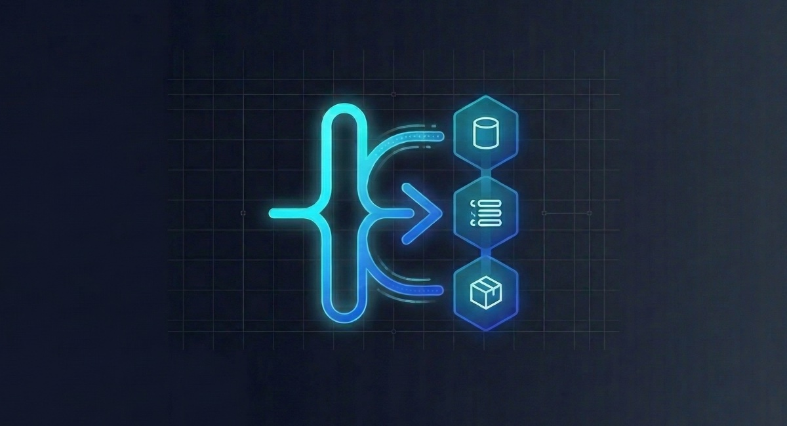
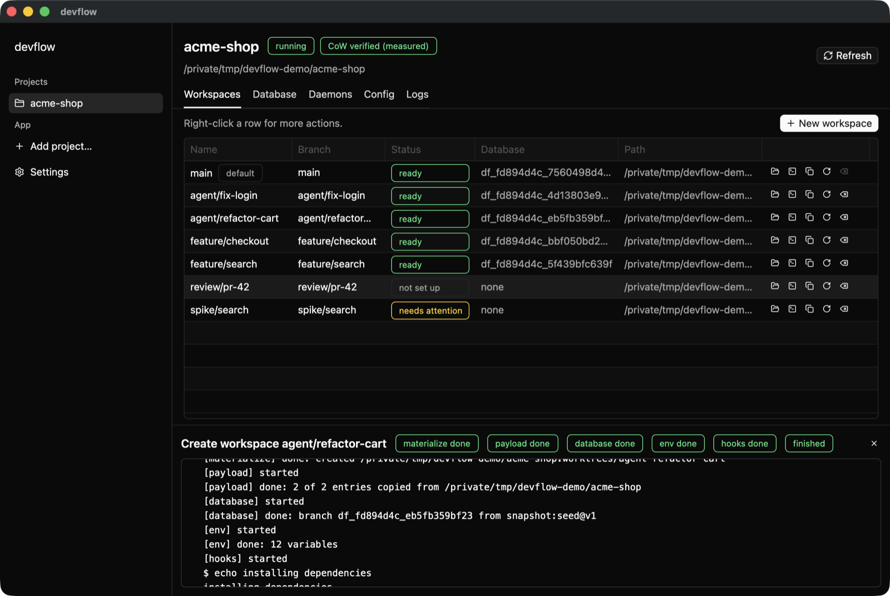
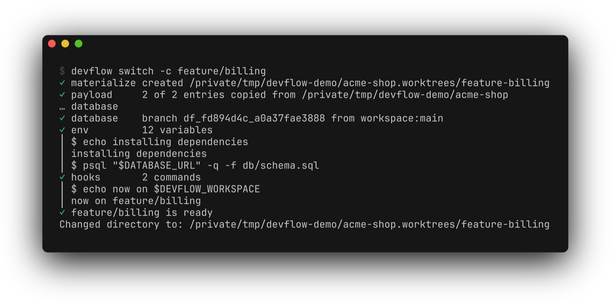
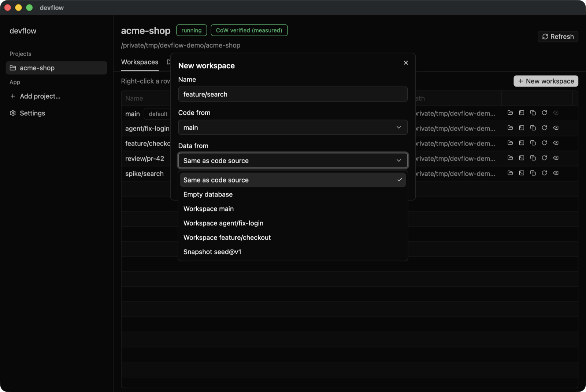
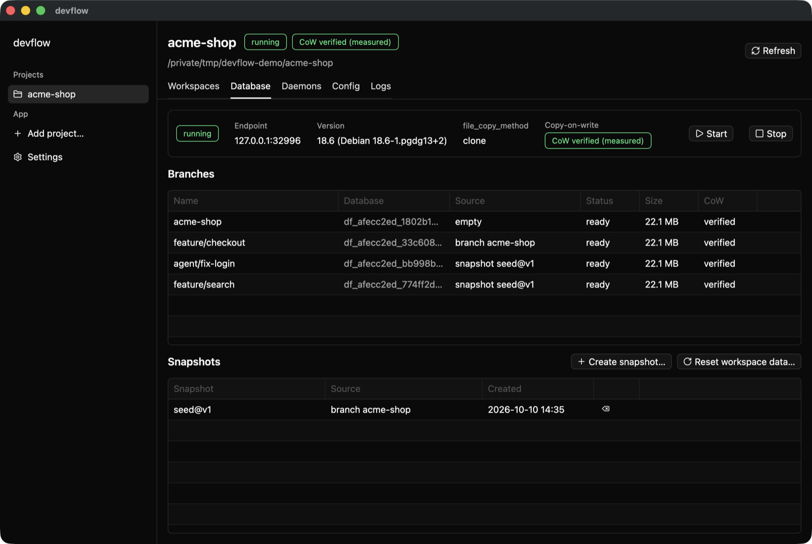

<p align="center">
  
</p>

<h1 align="center">devflow</h1>

<p align="center">Git worktrees with their own database, created in seconds.</p>

<p align="center">
  <a href="AGENTS.md">Agent guide</a> ·
  <a href="docs/MIGRATING.md">Migrating from 0.x</a> ·
  <a href="docs/REMOTE.md">Remote data hosts</a> ·
  <a href="docs/ARCHITECTURE.md">Architecture</a> ·
  <a href="CHANGELOG.md">Changelog</a>
</p>

<p align="center">
  
</p>

## What it does

devflow prepares an isolated development environment for each branch of a Git repository. It does four things, plus a desktop app:

1. **Worktrees.** Create, list and remove Git worktrees. Removal always refuses the default workspace and the one you are standing in. Dirty or locked worktrees need `--force`.
2. **Copy-on-write payloads.** Clone the ignored paths you list (`node_modules`, `.env`, build output) from the source worktree with APFS `clonefile` or Linux `FICLONE`. If the filesystem cannot share blocks, devflow copies.
3. **Postgres branches.** One PostgreSQL 18 server per project. Each workspace gets its own database, created with `CREATE DATABASE … TEMPLATE … STRATEGY FILE_COPY` and `file_copy_method = clone`, so on a reflink filesystem the new database shares blocks with its source.
4. **Hooks.** Trusted shell commands with `DATABASE_URL` in the environment: `setup` runs once in a new worktree, `switch` on every `devflow switch` into an existing ready workspace (and once after `switch -c` reaches ready), `teardown` before removal.

`devflow-gui` is a native desktop app (GPUI) over the same core: projects, workspaces, database branches and snapshots, setup logs and config editing.

## Why so little

The [jdx](https://github.com/jdx) tools now cover the rest, so devflow no longer builds it:

| Need | Use |
| --- | --- |
| Run dev servers, workers and schedulers; HTTPS names like `api.feature-x.shop.localhost` | [pitchfork](https://pitchfork.jdx.dev) daemons and its proxy |
| Install toolchains and dependencies, run tasks | [mise](https://mise.jdx.dev): `mise install`, `mise deps`, `mise run` |
| Share Rust build caches between checkouts | [Mr. Boxington](https://mr-boxington.jdx.dev) (`mbx`) |

None of them creates a worktree, prepares it, or branches database data. devflow does that and writes `.devflow/env` so those tools can pick up the result.

## Install

devflow embeds libgit2, so the `git` binary is not required. Managed Postgres needs Docker (or a compatible engine such as OrbStack); external mode needs a PostgreSQL 18 server instead.

```sh
# CLI release binary (Linux x86_64/arm64, macOS Apple Silicon) -> ~/.local/bin
curl -fsSL https://raw.githubusercontent.com/clement-tourriere/devflow/main/scripts/install.sh | sh

# or from source
git clone https://github.com/clement-tourriere/devflow.git && cd devflow
cargo install --path .

# desktop app (macOS 15+; not part of the release binaries)
cargo build --release -p devflow-gui        # target/release/devflow-gui
```

`devflow gui` starts the app; `devflow-gui` must be next to the `devflow` binary or on `PATH`. Linux needs Wayland or X11 with Vulkan for the GUI and is not yet advertised as supported. Set `DEVFLOW_INSTALL_DIR` or `DEVFLOW_VERSION` to change the installer's target or pin a release.

Optional shell integration, so `devflow switch` changes your directory:

```sh
eval "$(devflow shell-init zsh)"     # or bash, fish
```

## Quick start

```sh
cd ~/code/shop                        # any Git repository
devflow init --postgres managed       # writes devflow.toml with a stable project id (--name sets the name)
devflow db up                         # start the project's PostgreSQL 18 container
devflow trust                         # review and approve the [hooks] commands
devflow switch -c feature/x           # worktree + payload + database branch + .devflow/env + setup hooks
devflow list                          # workspaces, status, database, path
devflow remove feature/x              # teardown hooks, drop the branch's database, remove the worktree
```

<p align="center">
  
</p>

`devflow switch -c` prints the new worktree path (`devflow path feature/x` prints it again). The directory is the sanitized workspace name (`feature/x` becomes `feature-x`), so use the printed path rather than building it. The generated `.devflow/env` holds `DATABASE_URL`, the `PG*` variables and `DEVFLOW_*` identifiers. The directory ignores itself, so it never shows up in `git status`.

A minimal `devflow.toml` (see [`examples/`](examples) for complete ones):

```toml
[project]
name = "shop"
id = "0b3c9d2e-…"                # written by `devflow init`

[worktree]
dir = "../{project}.worktrees"   # relative to the main checkout; absolute and ~/ paths work too
copy = [".env", "node_modules"]  # cloned from the source worktree; omit to copy nothing (init writes [".env"])

[postgres]
mode = "managed"                 # or "external"
image = "postgres:18"

[hooks]
setup = ["mise trust", "mise install", "bun install"]
teardown = []
```

Machine-local overrides (an admin URL, a declared `cow`) go in `devflow.local.toml` beside it. It overlays every section, `[hooks]` included (tables merge, lists are replaced), and hook approval covers the merged result. It can hold an admin password, so keep it out of Git: `devflow init` does not edit `.gitignore` (this repository's `.gitignore` lists it; add it to yours).

### Database branches

A new workspace's database is a clone of the database of the workspace its code comes from (`--from`, else the default workspace), unless you pass `--data-from WS|snapshot:NAME[@vN]|branch:ID|empty`. The default workspace's database is created empty the first time something needs it: `switch -c` (which warns about it) or `devflow setup` in the main checkout.

Cloning needs the source database to have no open sessions. For a managed server bound to loopback, `on_busy_source` defaults to `disconnect`: creating a workspace from a live workspace terminates the open sessions of the source database. For external or non-loopback servers the default is `fail` and the clone is refused. Set `on_busy_source` under `[postgres]` to choose.

### Commands

| Command | Purpose |
| --- | --- |
| `init`, `trust`, `hook install\|uninstall` | Create the config (`--name` sets the project name, `--hook` also installs the Git hook), approve hooks (`-y` skips the question), install the post-checkout hook |
| `switch [-c] NAME`, `list [--all]`, `path NAME` | Create, enter and inspect workspaces; `--all` lists every registered project |
| `remove NAME` | Delete a workspace; `--keep-data` keeps its database branch, `--delete-branch` also deletes the Git branch, `--force` overrides dirty, locked and failing-teardown protections |
| `setup` | Run the same pipeline in an existing worktree (adopt, resume, fork) |
| `db status\|up\|down\|url\|psql\|reset\|reconcile` | Manage the server and a workspace's database |
| `db snapshot create\|list\|delete`, `db branch list\|create\|delete` | Reusable seed data and explicit branch control |
| `doctor`, `shell-init`, `completions SHELL`, `gui` | Diagnostics, shell integration, shell completions, desktop app |

All inspection and mutation commands accept `--json`; `db psql`, `shell-init`, `completions` and `gui` do not. Run `devflow --help` for flags.

## Desktop app

`devflow gui` (or `devflow-gui --project PATH`) opens the same operations in a window: create, set up and remove workspaces, approve hooks, follow each phase, start and stop the managed server, manage snapshots, and edit `devflow.toml`.

<p align="center">
  
</p>

Code and data origins are chosen separately, as with `--from` and `--data-from`.

<p align="center">
  
</p>

The Database page shows the server, whether clones share blocks (measured on this machine), every branch with its source, and the snapshots.

## Copy-on-write, measured

Branch creation speed and disk cost depend on the filesystem under the PostgreSQL data directory. devflow measures instead of assuming and reports `verified`, `copy` or `unknown`.

Benchmark (OrbStack, btrfs volume, PostgreSQL 18): a 392 MB database cloned in **0.93 s** and used **+0.2 MB** on disk. The default `WAL_LOG` strategy used +370 MB on the same database. `FILE_COPY` forces a checkpoint, so latency also depends on server activity. Your numbers will differ.

| PostgreSQL data directory on | Result |
| --- | --- |
| Managed server on OrbStack (named volume on btrfs) | `verified` |
| Linux btrfs, XFS with reflink, or ZFS 2.2+ | `verified` |
| ext4 | `copy`: a full copy per branch |
| Docker Desktop, or a macOS bind mount (virtiofs) | `copy`: a full copy per branch |
| External server | `unknown`, unless you declare `cow = "verified"` in `devflow.local.toml` |

Worktree payloads are cloned with `clonefile` on APFS and `FICLONE` on btrfs, XFS with reflink and ZFS 2.2+; on other filesystems they are copied.

`devflow doctor` reports the capability it found and whether it was measured or declared. Set `require_cow = true` under `[postgres]` to refuse branch creation when CoW is not verified. Without CoW, branches still work; they take longer and use the full database size.

## Composing with pitchfork and mise

devflow's job ends at `.devflow/env`. Let mise load it for every command in the worktree:

```toml
# mise.toml
[tools]
bun = "1.2"

[env]
_.file = ".devflow/env"
```

Declare daemons in a committed `pitchfork.toml`; pitchfork discovers each worktree and namespaces its daemons:

```toml
# pitchfork.toml
[daemons.api]
run = "mise exec -- bun run dev"
```

The daemon sees `DATABASE_URL` through mise, in every worktree, with its own database. The GUI lists a workspace's pitchfork daemons and can start and stop them. Ready checks, retries and proxy settings are pitchfork options; see its documentation.

## Agents and automation

```sh
devflow --json --non-interactive switch -c agent/fix-login   # read workspace.path from the output
```

- `--json` prints one versioned document; `--non-interactive` disables prompts. Exit code 2 means the workspace is not `ready` (`needs_attention` or `in_progress`).
- Untrusted `[hooks]` are skipped in non-interactive mode and the workspace is marked `needs_attention`. Run `devflow trust` once (`-y`/`--yes` approves without asking), or set `DEVFLOW_TRUST_HOOKS=1` for a single run in CI.
- Worktrees created by other tools (T3 Code, Claude Code, plain `git worktree add`) are prepared by a `post-checkout` hook: `devflow hook install` once, or `devflow init --hook`. The hook does nothing unless `devflow` is on the `PATH` of the process running Git.

See [AGENTS.md](AGENTS.md) for the full contract and [`examples/agent-task.sh`](examples/agent-task.sh) for a script.

## Remote data hosts

Run PostgreSQL 18 on an always-on machine with a reflink filesystem and branch from laptops, VM forks or cloud sandboxes. A trusted machine holds the admin credentials and provisions branches; a sandbox receives only its branch URL. There is no TLS in 1.0, so use a private network. See [docs/REMOTE.md](docs/REMOTE.md).

## What changed in 1.0

1.0 is a deliberate simplification: process supervision, the proxy, the TUI, Jujutsu, non-Postgres services, cloud providers, baselines, hook templating and the Tauri app are gone. 1.0 reads `devflow.toml` (or `.devflow.toml`) plus `devflow.local.toml` and never adopts 0.x resources. [docs/MIGRATING.md](docs/MIGRATING.md) lists each replacement and how to move your data.

## License

MIT
