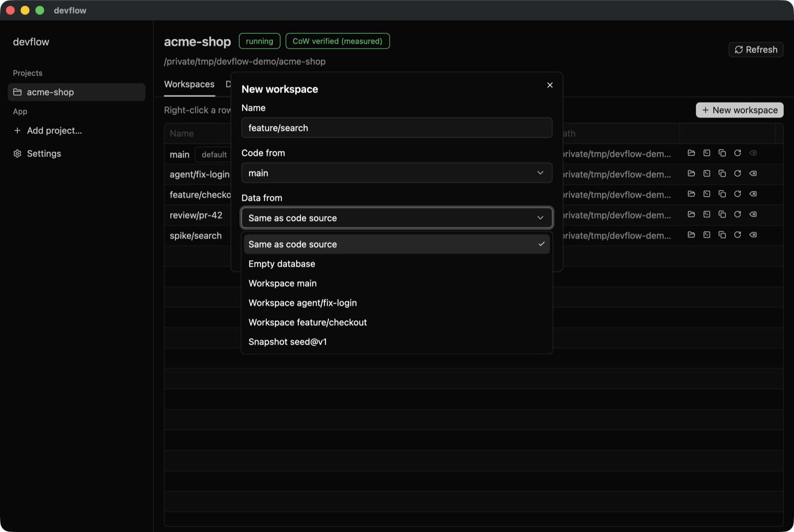
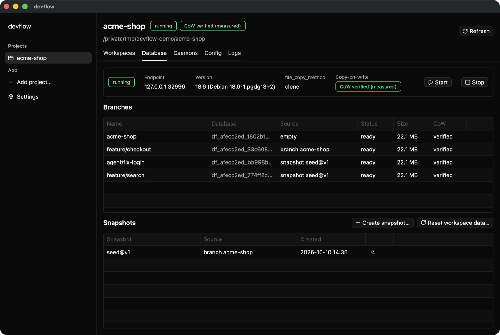
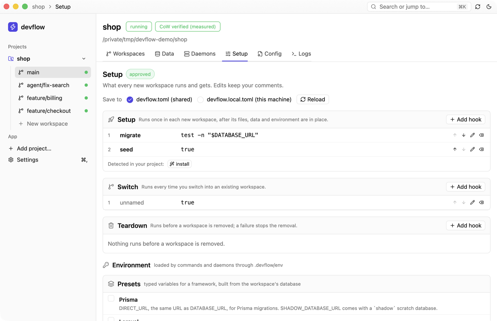

# Desktop app

`devflow gui` (or `devflow-gui --project PATH`) opens the same operations in a window: create, set up and remove workspaces, review and approve what the project runs, follow each phase, start and stop the managed server, manage snapshots, and edit `devflow.toml`.

  

Code and data origins are chosen separately, as with `--from` and `--data-from`.

  

The PostgreSQL page of the Data tab shows the server, whether clones share blocks (measured on this machine), every branch with its source, and the snapshots.

The Data tab (⌘2) lists every data service of the project as a card: PostgreSQL first, then each container service (Valkey, Redis, MySQL, whatever core supports; the app never branches on the engine). A container service's page shows its image, the Docker engine it is bound to, and whether clones share blocks (`verified`, `copy` or `unknown`, read from the cache; **Measure** runs the probe on request). Each branch lists its owner workspace (from the receipt's instance id, never from a name), state, endpoints, source, capture time and last clone, including how long a MySQL source was stopped for the copy. **Copy URL** shows the URL masked on screen and puts the full URL on the clipboard. Start, stop, snapshot, delete a snapshot, reset (after a confirmation that says what is lost), reconcile, and dropping or forgetting orphans (also behind a confirmation) are background jobs with their progress and errors in the activity log; a long one also shows in the title bar.

  

The Setup tab (⌘4) edits the hooks and `[env]` without opening a file: named rows that can be added, reordered, edited and removed, commands detected in the project offered with one click, and the framework presets. Edits keep the file's comments, go to `devflow.toml` or `devflow.local.toml`, and are approved before they run like any other change. A change made outside the app (`devflow env preset add`, an editor) shows up on the next refresh (⌘R) or when the window is activated again; while a form is open the tab keeps it and says the file changed, with a Reload button. ⌘⇧L switches between the light and dark themes (also the sun/moon button in the title bar).

The Workspaces tab opens on an overview of the project: workspaces by status, services and their branches, processes running, the disk copy-on-write saved (always an upper bound, "up to", from the apparent size of what was cloned; unread paths are marked incomplete) and the last activity, with **New workspace** as its one primary action. A selected workspace's detail lists its processes with the state, port and a clickable proxy URL, and Start, Stop and Restart gated by the same checks as the Daemons tab (including **Review and start…** when the approval must be renewed). When core refuses, the refusal is shown with its explanation: a `.devflow/env` mise does not deliver says so and offers **Run doctor**. Its Connections list shows container bindings beside PostgreSQL.

Pitchfork is offered in the setup wizard (when the plan involves processes) and in the Daemons tab: if it is missing, the install command is shown first and runs only on a click; the proxy's `sudo` commands are only ever copy buttons. The command palette (⌘K) adds entries that exist only when they apply: start, stop and restart processes, open a daemon's URL, snapshot or reset data, install pitchfork and run the doctor.

## Setting up from the app

A project with no `devflow.toml` opens on one button, **Set up devflow…** (also in the command palette and a project's context menu, where it adds what is still missing to a project that is set up already). It is the same plan-then-apply as `devflow init`, in six steps with Back and Next (Enter and the arrow keys work too):

1. **Detected**: what devflow found, as plain facts (languages, package managers, migration tools, compose services, mise and pitchfork files). Nothing ran and no `.env` value was read.
2. **Proposal**: the items core proposes, grouped, each with a checkbox at its default, a confidence, the reason and a detail you can open. Choose a managed PostgreSQL server, an existing one, or none.
3. **Review**: the exact lines added to each file, green and red, before anything is written.
4. **Apply**: core writes the files atomically and lists them. If the repository changed since the plan, nothing is written and you are offered to plan again.
5. **Approve**: the commands and `[env]` recipes an approval covers, and the button. Skipping leaves them unapproved.
6. **Done**: what to commit, and **Create your first workspace**.

Once a project is set up, the **Setup** tab (⌘4) keeps it that way without opening TOML: the three hook phases with what each is for, an add-hook form with hooks detected in your project as suggestions, reorder, edit and remove, the framework presets and the `[env]` variables with their resolved values masked (reveal on request), a switch between the shared `devflow.toml` and your own `devflow.local.toml`, and a banner when what the project runs needs your approval. Every save is a core edit: comments stay, an invalid value is refused under the form, and a file that changed on disk is never overwritten (*devflow.toml changed on disk — reload*).

Selecting a workspace in the Workspaces tab shows its detail below the table: the phases of its setup with how long each took, errors and **Retry setup**, its connections (host and container endpoints, passwords masked, copy and reveal) with its scratch databases, and what it costs in time and disk. Disk is reported as the file system reports it: for each payload path the apparent size (the sum of the file lengths) and the allocated size (blocks, with blocks shared with the source counted in full and directory metadata left out), marked incomplete when some entries could not be read; a cloned payload is never reported as costing zero.
