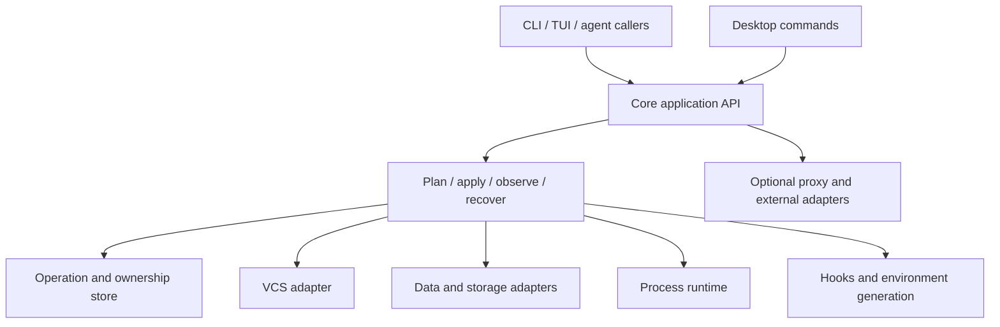

Devflow should concentrate on **creating, reusing, resetting, and retiring a development environment containing code, data, and processes**. The strongest next step is to make that lifecycle consistent across humans and agents, then add immutable data baselines. Several features can be removed or reduced to make room for that work.

This is the second review, dated 2026-09-14, of the current working tree, including the changes documented in [the first implementation pass](implementation.md). It contains recommendations and new evidence; production code was not changed during this pass. Feature removal recommendations reflect the stated product goal, not measured usage. There is no usage telemetry establishing that a particular integration is unused.

The first pass improved important foundations: exact resource ownership, distinct code/data origins, confined file actions, clone leases, streamed imports, worktree recovery, and optional build features. Those improvements should stay. Four new CLI probes nevertheless demonstrate gaps that the existing passing tests did not cover.

The source inventory covers 192 Rust/TypeScript/TSX files and 75,305 lines. It includes inline tests and excludes separate test directories, documentation, CSS, and generated output. Size identifies places to inspect; it does not prove that code is unnecessary. The reproducible counts and largest files are in [architecture-inventory.json](architecture-inventory.json).

| Area | Files | Lines | Main concern |
| --- | ---: | ---: | --- |
| Core | 82 | 35,923 | Provider contracts, multiple state stores, process supervision, lifecycle policy |
| CLI and TUI | 41 | 17,965 | Presentation and lifecycle decisions mixed together |
| Desktop Rust | 13 | 3,994 | Direct provider calls and separate configuration construction |
| React UI | 41 | 13,119 | Large project screen and extensive configuration/recipe editors |
| Proxy | 14 | 3,999 | A substantial networking subsystem adjacent to the main product |
| Terminal | 1 | 305 | Small Rust adapter; frontend terminal is already loaded on demand |

The immediate correctness findings are below. P1 means potential data loss or execution outside the intended setup/argument contract; P2 means a misleading or incomplete operation that blocks dependable automation.

1. **P1 — Cleanup can attempt to delete the configured default data branch.** With `git.main_workspace: trunk`, a fake Neon project containing `trunk` and `scratch`, and `service cleanup --max-count 0`, devflow issued DELETE requests for both branches and returned success. The default [provider cleanup implementation](../../../crates/devflow-core/src/services/mod.rs#L131) protects only the literal names `main` and `master`; the [CLI call](../../../src/cli/service.rs#L1499) does not supply configured protections. A real provider might reject deletion of its protected branch; the reproduced defect is that devflow attempts it. Move retention decisions into core and protect configured defaults, active workspaces, pins, and actual data dependencies before issuing provider mutations. Preserve failed deletions in the result instead of only logging them.

2. **P1 — Arguments after `switch -x ... --` are reinterpreted by a shell.** Passing the single argument `hello world` to a capture program produced two arguments, `hello` and `world`. [Execution construction](../../../src/cli/workspace/exec.rs#L45) joins arguments with spaces and [foreground execution](../../../src/cli/workspace/exec.rs#L215) passes the string to `sh -c`. This also makes shell metacharacters significant where callers supplied argument data. The probe used a harmless space-containing argument. Preserve a program and argument vector, with an explicit separate shell-command mode for callers that want shell syntax. Apply the same rule to detached execution and paths containing spaces.

3. **P1 — Readiness enforcement changes with the output format.** A skipped, unapproved pre-switch hook caused JSON-mode `switch -x` to report `operation.status: needs_attention` and skip execution. The equivalent human-mode command printed the warning and executed anyway. [The execution gate](../../../src/cli/workspace/mod.rs#L243) reads readiness from the JSON presentation value, which the human path does not populate. Return a typed switch outcome from core and decide whether to execute before rendering either output format. Preserve the useful contract that incomplete setup still returns the materialized worktree path.

4. **P2 — Reset can succeed without resetting anything.** A generic Redis service accepted `service reset never-created` and returned exit 0 with `status: ok`. No workspace or container was needed. The [provider trait](../../../crates/devflow-core/src/services/mod.rs#L117) defaults reset to successful no-op, generic Docker advertises lifecycle support, and [CLI reset](../../../src/cli/service.rs#L1600) uses that broad capability. [Desktop reset](../../../src-tauri/src/commands/services.rs#L550) calls the provider directly. Separate start, stop, reset, seed, and snapshot capabilities. Unsupported operations must return a typed error; successful reset must identify and verify the resulting data generation.

All four observations are captured in [architecture-probe-results.json](architecture-probe-results.json), including the binary SHA-256 and enabled features. The historical Python harness was retired in the native-library refactor. Maintained regressions now live in [CLI tests](../../../tests/review_cli.rs) and [core architecture tests](../../../crates/devflow-core/tests/architecture_contracts.rs); run them through Cargo. The captured cloud-cleanup probe used a loopback HTTP fixture, not a live account.

There is also a **P1 failure path established by source inspection, not a Linux runtime test**: [ZFS cloning during reset](../../../crates/devflow-core/src/services/postgres/local/storage/zfs_driver.rs#L195) creates the parent snapshot, removes the existing child dataset, and only then attempts the replacement clone. If that clone fails, cleanup removes the new snapshot but does not restore the old child. [Reset invokes this path](../../../crates/devflow-core/src/services/postgres/local/mod.rs#L742). The ordinary filesystem staging fix therefore does not establish equivalent ZFS guarantees. Stage a replacement dataset, validate it, and perform a recoverable cutover retaining the previous generation until success. OpenZFS documents replacement using clones, promotion, and renaming; choosing the exact sequence requires mount/container coordination and Linux failure tests. [OpenZFS clone documentation](https://openzfs.github.io/openzfs-docs/man/master/8/zfs-clone.8.html).

The first removal batch should target demonstrably misleading or redundant surface area:

| Candidate | Evidence | Recommendation |
| --- | --- | --- |
| `agent.auto_context` and its editor toggle | [The field](../../../crates/devflow-core/src/config/mod.rs#L366) has no runtime reader; references are configuration, UI, and documentation. | Stop exposing the toggle. Keep explicit `agent context`; accept the old field temporarily with a deprecation message. |
| `worktree.respect_gitignore` | [The field](../../../crates/devflow-core/src/config/mod.rs#L436) is parsed/tested but never consulted by worktree creation. Actual behavior uses `copy_ignored`; `--no-respect-gitignore` overrides that different field. | Keep one explicit copying policy and a positive `--copy-ignored` spelling. Migrate old configuration deliberately instead of continuing a nonfunctional switch. |
| `template_from_time` capability | [Neon advertises it](../../../crates/devflow-core/src/services/postgres/neon.rs#L302), but the provider create interface and request path accept no timestamp. | Remove the claim until callers can actually request a timestamp or snapshot through a typed data source. |
| Legacy container-discovery helpers | [local_docker.rs](../../../crates/devflow-core/src/services/local_docker.rs#L119): `service_workspace_prefix` has only test callers; `list_managed_service_containers` has no in-repository callers. Its private prefix-based identity helper is used only by that path and tests. | Delete the unused path and its implementation-specific tests, subject to any published Rust API compatibility commitment. Keep exact ownership and explicit adoption paths. |
| Superseded PostgreSQL Docker helpers | [docker.rs](../../../crates/devflow-core/src/services/postgres/local/docker.rs#L272): `stop_workspace_for_clone` and the method `start_existing` have no in-repository callers. | Remove them; current cloning uses the leased quiescence helper. The separate `shared/container.rs` function named `start_existing` is active and should stay. |
| Duplicate guide/skill entry points | [agent.rs](../../../crates/devflow-core/src/agent.rs#L207) wraps guide generation under old skill names; desktop exposes both sets of commands. | Use one guide implementation and one frontend API. Keep only thin compatibility aliases and explicit cleanup of old generated formats during migration. |
| Stale agent documentation | [CLAUDE.md](../../../CLAUDE.md#L31) still calls TOML read-only, shows broad AI-config copying enabled, and describes four crates where the workspace has five. | Correct the guide and generate command/capability facts from the tested manifest. Keep project-specific explanations handwritten. |

`cargo machete` found no unused dependencies. Dependency removal should follow removal of a real feature; there is no evidence here for a broad manifest cleanup.

For larger product cuts, these are my recommendations:

| Feature | Decision | Reason and retained behavior |
| --- | --- | --- |
| AI tool permission/configuration merging | Remove the special merging feature. | [ai_configs.rs](../../../crates/devflow-core/src/ai_configs.rs#L36) merges permission arrays from a task worktree back into the primary checkout and additively copies tool directories. This couples workspace operations to tool-policy semantics. Keep generated guides and explicit file-copy allowlists. Defaulting broad copying off was useful, but leaves this separate feature in place. |
| Built-in LLM API commit generation | Deprecate and remove the API backend and its credential/model settings. | [llm.rs](../../../crates/devflow-core/src/llm.rs) is unrelated to data/worktree reuse. External commands already cover commit generation. A small compatibility wrapper can remain while callers move to their existing tools. |
| Embedded Pitchfork runtime and configuration/Web UI integration | Retain one native runtime; move external-supervisor support behind a narrow adapter. | [processes/mod.rs](../../../crates/devflow-core/src/processes/mod.rs) mixes both implementations across 4,102 lines. Its own [log redirection explanation](../../../crates/devflow-core/src/processes/mod.rs#L2730) shows the lifetime mismatch of embedding a supervisor in a short-lived CLI. Keep start, readiness, logs, stop, and dependency ordering as core capabilities. |
| Proxy, CA, NSS, mDNS | Extract as an optional companion with a clear endpoint interface. | Stable workspace URLs are useful. Maintaining all networking and host integration inside the primary product is expensive. The CLI already feature-gates the proxy; [desktop still depends on it unconditionally](../../../src-tauri/Cargo.toml#L14). Keep the existing subsystem until the optional integration is usable. |
| Extensive hook recipe and configuration GUI | Reduce the default UI to workspaces, data origins, readiness, connections, logs, and a good raw config editor. | HookManager and HookEditModal alone contain 2,541 lines, in addition to core recipes and CLI/desktop handlers. Keep typed hooks and inspection; defer the comprehensive recipe form builder and duplicate editors. |
| Cloud adapters and Jujutsu | Keep optional/experimental; pause breadth expansion until contract tests exist for supported behavior. | These can serve real users. There is no usage evidence justifying deletion. Jujutsu needs native workspace tests; cloud adapters need live-service validation in addition to mocked HTTP tests. Do not move adapters to plugins before the plugin contract can preserve their guarantees. |
| Shared Redis as the universal cache default | Make the allocation limit visible and offer a per-workspace container choice. | [The implementation caps allocation at DB 15](../../../crates/devflow-core/src/services/shared/redis.rs#L28), leaving only 15 allocated workspace slots on that shared engine. This is a poor implicit choice for many concurrent agent workspaces. The limit is this implementation's policy, not a claim that Redis can never be configured differently. |

Keep both shared PostgreSQL and separate-container PostgreSQL. They solve different resource/isolation needs. Also keep raw VCS identity separate from service keys, immutable creation provenance, the independent code/data origins, JSON inventory, exact legacy adoption, read-only diagnostics, and the newly added ownership protections. Old data migrations are not dead code merely because their names contain “legacy.” Remove migration support only through a documented compatibility window and explicit migrator.

The architectural change should start inside the existing core crate. Creating more crates by itself would not fix the observed behavior. The target dependency direction is:



**One application API should own lifecycle decisions.** CLI, TUI, desktop, hooks, and the controller should submit typed requests to the same operations. They should format outcomes and collect input. Start with switch/execute, reset, and cleanup because the probes show concrete disagreement there. [CLI service management](../../../src/cli/service.rs), [desktop service management](../../../src-tauri/src/commands/services.rs), and TUI setup currently construct or invoke service operations separately. The JSON stdout collector is a useful compatibility layer, but application decisions must not depend on serialized presentation values.

**Provider operations and capabilities should form one contract.** Introduce typed operation support instead of one `lifecycle` Boolean and several independent overrides. Separate observation from mutation: shared providers' `test_connection` methods currently call `ensure_ready`, and the controller uses that to start engines. Name these effects explicitly. A provider should perform a resource operation; core should decide whether it is allowed and which resources to retain. This is where default-workspace protection belongs.

Use one provider descriptor for supported configuration, compiled availability, data strategy, and operations. Generate the frontend types and selection choices from it. Today the [desktop form offers all three cloud providers](../../../ui/src/components/AddServiceModal.tsx#L347), while the desktop manifest enables none by default, and [configuration construction](../../../src-tauri/src/commands/services.rs#L233) leaves cloud credentials unset. This source mismatch was not exercised in a running GUI. Hide unavailable choices and make required setup visible before saving. Prefer a tagged backend configuration over a provider string plus many unrelated optional blocks.

**State needs one authoritative owner for each fact.** Workspace registration lives in LocalStateManager; local PostgreSQL has SQLite records; shared ownership, operations, and processes have their own files; [desktop settings](../../../src-tauri/src/state.rs#L12) maintain another project list. These stores should not independently decide project/workspace identity or desired lifecycle state. Introduce stable `ProjectId`, `WorkspaceId`, `ServiceId`, and `ResourceId` values, with paths and branch names as attributes. Preserve existing service keys during migration. A stable configured project ID already helps resource naming, but [operation identity still hashes the project path](../../../crates/devflow-core/src/workspace/operation.rs#L59).

A single core state interface should own identities, resource references, desired state, and operation checkpoints. SQLite is a plausible implementation because the project already uses it, but making it mandatory needs a minimal-build dependency/size check. Backend observations remain backend observations. A local transaction cannot atomically commit Docker, Git, and remote API changes: persist intent, perform the external action, checkpoint the result, then reconcile after interruption.

**Extend the journal into recoverable operations, incrementally.** The new [OperationJournal](../../../crates/devflow-core/src/workspace/operation.rs) is a useful starting point. It currently records string phases and a special `post_create_pending` flag; a completed operation is replaced by the next operation of the same workspace/kind. Generalize to typed steps with per-service outcomes, attempts, config/source fingerprints, and bounded history. Cover seed, reset, and cleanup as well as switch/remove. Persist replacement generations until cutover succeeds. Classify hooks as required or optional and record background completion; merely spawning a hook does not prove that setup is ready. Arbitrary shell hooks need an explicit retry/idempotency contract, not an exactly-once promise.

**One controller should own each long-running resource.** The CLI daemon reconciles shared engines and desired processes; the desktop separately starts an in-process proxy and stores its settings. Embedded Pitchfork adds another supervisor model. Persist explicit desired state and let one controller/runtime adapter act on it. CLI and desktop should observe the same process/proxy status. Ordinary workspace commands should remain usable without a permanently running daemon; enable a controller only for requested background behavior.

**Make plugins capable of preserving core guarantees before expanding their role.** The current [request envelope](../../../crates/devflow-core/src/services/plugin.rs#L111) has a method, params, config, and service name. Add protocol negotiation, capability discovery, stable resource identity, operation/idempotency IDs, deadlines, and structured errors. An invocation timeout already exists; it is not a complete cancellation/recovery protocol. [Lifecycle support currently defaults to true](../../../crates/devflow-core/src/services/plugin.rs#L313), and cleanup policy is delegated wholesale. Resolve [relative executables](../../../crates/devflow-core/src/services/plugin.rs#L75) against the project/configuration root instead of the caller's current directory. Keep retention policy in core even for plugin resources.

The highest-value new feature is **a named, immutable, versioned data baseline**. Today `--data-from` identifies a workspace whose data can subsequently change. Local PostgreSQL reset clones its parent at reset time, so the same command need not reproduce the same initial dataset. Separate reusable data from a developer's active workspace: prepare a baseline by importing/seeding, migrating, validating, recording engine/source compatibility, then sealing that generation. Children record the exact baseline version, and reset returns to that version unless explicitly asked to rebase onto another.

This also addresses source interruption. Local physical cloning quiesces the parent container, while shared PostgreSQL [terminates template connections](../../../crates/devflow-core/src/services/shared/mod.rs#L190). PostgreSQL requires a template database to have no other connected sessions when cloning begins. A dedicated sealed template avoids repeatedly disrupting an active developer database; it does not eliminate the database's cloning constraints. [PostgreSQL CREATE DATABASE documentation](https://www.postgresql.org/docs/current/sql-createdatabase.html).

Illustrative future syntax, **not commands implemented by this review**:

```text
devflow baseline prepare clean --service db --from ./fixtures/base.sql
devflow switch -c agent/task-42 --from main --data-from baseline:clean@v3
devflow exec --workspace agent/task-42 -- pytest -k "login or signup"
devflow operation inspect <operation-id> --json
devflow operation resume <operation-id>
```

Resolve data origins per service: PostgreSQL may clone a baseline, Redis may start empty, and object storage may copy a fixture set. Report that distinction and the actual strategy rather than implying every service branches data. Begin with one PostgreSQL baseline path; add multi-service baseline bundles after the single-service prepare/clone/reset lifecycle is reliable.

Next, make **resource retention and reuse explicit**. Extend the existing cleanup/GC work through one previewable plan supporting pins, optional expiry, active-operation leases, and budgets. Age alone must not authorize deletion. A deleted code parent remains provenance; a live data dependency may prevent deletion until it is detached or materialized. Honor Git worktree locks as well as devflow pins; Git already provides lock, repair, and prune semantics. [Git worktree documentation](https://git-scm.com/docs/git-worktree).

Finally, distinguish **cache reuse from data cloning**. Give projects explicit allowed cache paths and policies: immutable/shared caches where valid, writable per-workspace copies where required. Fingerprint reusable build/dependency artifacts by their relevant inputs. Avoid treating all ignored directories as interchangeable reusable state. Add clone/reset benchmarks measuring elapsed time, bytes copied, peak resource use, and parent downtime at several dataset sizes and concurrent workspace counts. Add a bounded pool of prepared clones only if those measurements justify its complexity.

The implementation order should be small, reviewable changes with behavioral acceptance criteria:

| Order | Change | Acceptance evidence |
| --- | --- | --- |
| 1 | Fix the four reproduced contracts and ZFS replacement failure handling. | Argument-vector tests; human/JSON readiness parity; real reset-or-unsupported outcomes; configured-default cleanup protection; Linux failures injected before and after dataset cutover. |
| 2 | Remove dead helpers and misleading settings/capability claims; correct stale guides. | Reference search, supported old-config migration fixtures, minimal/default/all-feature checks. No tests that only prove an unused setting parses. |
| 3 | Route switch/execute, reset, and cleanup through typed core application operations. | The same contract fixtures exercise CLI and desktop entry points; failure/readiness semantics match. |
| 4 | Centralize identity/desired state and extend operation recovery. | Concurrent attempts, process interruption, project relocation, and partial multi-service failures preserve ownership and resumable intent. Migrate one store at a time. |
| 5 | Deliver versioned PostgreSQL baselines and exact-version reset. | Prepare once, create independent children, mutate the source workspace, reset a child to its recorded version, and verify data plus parent availability. |
| 6 | Retire AI-policy merging and API commit generation; extract optional supervision/proxy/UI breadth. | Existing configuration has explicit migration paths; the core workspace workflow works without those integrations. Keep a compatibility cleanup path for existing runtime resources. |

Verification in this pass comprised the four disposable CLI probes, cross-repository reference searches, source inventory, and `cargo machete` (no unused dependencies detected). This was not a fresh run of the full Rust/Docker/frontend suite from the previous implementation pass. The source-inspected ZFS and desktop findings require their platform tests; live cloud accounts, Jujutsu, S3, and large-dataset performance were not validated here. The suggested architecture is an incremental migration of the current project, with the concrete contract fixes first and reusable baselines as the first substantial new capability.
