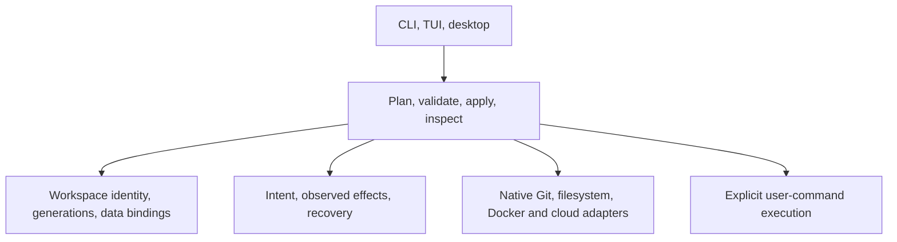

# Third architecture review

Reviewed commit: **`37a3a9a63ec561653504771603d372d2bc5a6b1b`**, committed on `refactor/workspace-data-architecture` before this pass. The implementation commit contains 199 changed files and the previous validation evidence. This review is a separate, uncommitted artifact.

**Keep the focus on reliable code/data workspaces. Fix the remaining lifecycle defects and finish removing redundant interfaces before adding more infrastructure.** The new baseline model is valuable, but name reuse, transitive data inheritance, and partial teardown are not yet dependable. The user's additional request to minimize subprocesses is addressed in [the subprocess audit](subprocess-audit.md), with a [57-site inventory](subprocess-inventory.json).

Seven defects were reproduced against the committed implementation's CLI, including two with real disposable PostgreSQL resources. One additional data-loss path was established by source inspection. Full observations, the commit ID, and binary SHA-256 are in [architecture-pass-3-results.json](architecture-pass-3-results.json). The newly written Python process-launching harness was removed at the user's request; the written reproduction steps and captured results remain.

## Correctness findings

### R1 — P1: Recreating a workspace silently reuses its deleted incarnation's baseline

Prepare `baseline:base@v1` containing a table with value `v1`. Create workspace `reused-name` from it, remove that workspace including its service, prepare `baseline:base@v2` containing `v2`, then recreate `reused-name` with `--data-from baseline:base@v2`.

The recreation returned success and recorded `operation.data_parent` and inventory `data_parent` as **v2**, but an actual SQL query returned **v1**. `control.data.db.reference` still pointed to v1. The same inventory described the workspace as ready.

[Unregistration](../../../crates/devflow-core/src/state/local_state.rs#L892) removes the old workspace listing but retains its control data. [Origin binding](../../../crates/devflow-core/src/baseline.rs#L304) skips every service already present in that retained map. An old name therefore selects an old data origin after a complete removal.

**Change:** distinguish a workspace's logical identity from its resource generation. Finish deletion with an explicit disposition for bindings, including the separate `--keep-services` case. A fresh creation must resolve and persist its requested origin; a retry of the same creation must retain its original origin. Test deletion/recreation with different baselines, a removed old baseline, ordinary data parents, and retained services.

### R2 — P1: Transitive baseline descendants use a mutable engine tag

Prepare a baseline with image A, create a child from it, change a probe-owned image tag to image B, then create a grandchild from the child. The grandchild ran image B even though its baseline ancestor and direct child used the recorded image A. The probe changed only image metadata to keep PostgreSQL compatible; a major-version change was not needed to demonstrate the wrong selection.

[Creation](../../../crates/devflow-core/src/services/postgres/local/mod.rs#L523) checks only whether the immediate parent is sealed, then falls back to the project's mutable image tag. The existing `workspace_image` helper can resolve ancestors but is not used there. Reset also left the grandchild on B: [Docker startup](../../../crates/devflow-core/src/services/postgres/local/docker.rs#L146) restarts an existing container without checking whether its image matches the requested specification.

**Change:** resolve an exact engine identity from the data generation for every create/start/reset path, and verify the actual container specification before reuse. Recreate an incompatible stopped container while preserving its data through the existing recovery protocol, or fail before mutation with a clear repair requirement. Test multiple ancestry levels and tag changes; checking only the requested image on a direct baseline child is insufficient.

### R3 — P2: Cache reuse ignores the destination branch's inputs

The primary checkout had `lock.txt = dependencies-A` and an ignored cache containing `compiled-for-A`. Another committed branch had `lock.txt = dependencies-B`. Switching to that branch copied `compiled-for-A` into it and returned ready.

[Materialization](../../../crates/devflow-core/src/cache.rs#L167) fingerprints only the source checkout. [Worktree setup](../../../crates/devflow-core/src/workspace/worktree.rs#L140) always supplies the primary checkout as that source; the destination lockfile never participates in eligibility. This defeats the cache's advertised input-based correctness across branches.

**Change:** derive the required key from the destination checkout, compare it with the source artifact's key, and materialize only a match. A cache miss should allow normal setup/rebuild rather than introduce an unrelated stale artifact. Preserve the explicit handling of existing mutable copies. The probe also switched back to the primary successfully; that suspected issue was not reproduced.

### R4 — P2: A rejected removal can permanently block execution in a healthy workspace

`exec --workspace main -- /usr/bin/true` succeeded. `remove main --force` correctly refused to delete the default/current workspace. A subsequent `switch main` succeeded, but the same `exec` then failed because a pending removal needed attention.

[Deletion](../../../crates/devflow-core/src/workspace/delete.rs#L303) begins a durable operation before its policy preflight. The rejection is retained as a failed pending removal, and [execution](../../../crates/devflow-core/src/execution.rs#L122) blocks on any pending operation for that name. Resuming this removal can never succeed under the default-workspace protection, and there is no cancellation command.

**Change:** perform non-mutating policy validation while holding the necessary lease before recording destructive intent, or record policy rejections as terminal operations that do not imply incomplete effects. Preserve failed operations that really did mutate resources. Add explicit, constrained cancellation/repair for existing records and test rejected default, pinned, locked, and dirty removals followed by continued use.

### R5 — P2: Project destruction reports success after worktree removal fails

The probe made the parent directory of a disposable worktree non-writable and ran `destroy --force`. Removal failed with permission denied, and the worktree directory remained. Nevertheless, the command returned exit 0, `status: ok`, `state_cleared: true`, and `config_deleted: true`.

[Destruction](../../../crates/devflow-core/src/project.rs#L212) logs worktree failures and proceeds to erase configuration and ownership state. [Success calculation](../../../crates/devflow-core/src/project.rs#L74) omits worktree, hook, and configuration failures. The desktop uses the same core path with non-forced worktree removal, so source inspection also shows that skipped dirty worktrees do not make its outcome incomplete.

**Change:** return per-resource teardown outcomes and retain the references required for retry until all requested cleanup succeeds. Preview/preflight worktree protections before destroying service data. Test filesystem/VCS failure after service deletion and the desktop's dirty-worktree path. Force accepts a destructive operation; it should not turn a failed operation into success.

### R6 — P2: Failed command launch leaves a fictitious running execution

Executing a nonexistent program returned an error, but `list` showed `execution_status: running` for the workspace. No command had started.

[Execution state](../../../crates/devflow-core/src/execution.rs#L134) is marked running before spawning. Errors from [launching the command](../../../crates/devflow-core/src/execution.rs#L293) return before the terminal state update. Retention policy trusts running/detached records, and the record has no execution-specific ownership lease or liveness identity.

**Change:** use a distinct execution record with starting/running/failed/exited states, a completion guard, and verifiable process/session ownership. Cover spawn failure, multiplexer failure, cancellation, and simultaneous executions. A failed spawn should never leave an active execution protection behind.

### R7 — P2: The controller permits multiple owners and reports them as stopped

Two `daemon start --foreground --interval 1` processes ran simultaneously against the same isolated config directory and wrote reconciliation status. `daemon status` reported `running: false` and `pid: null` while both were alive. Both test-owned processes were stopped afterward.

The [start guard](../../../src/cli/daemon.rs#L83) applies only to detached startup. The [foreground loop](../../../src/cli/daemon.rs#L267) has no exclusive owner registration. Detached startup also uses a PID-file check/write rather than an atomic ownership lease.

**Change:** if the controller stays, give it one OS-backed ownership lease shared by foreground and detached launches, with truthful status and shutdown. Move reconciliation entry points into core and let a single explicit controller drive them. Removing devflow-managed daemonization is also consistent with the requested subprocess reduction.

### R8 — P1, source-confirmed: PostgreSQL's staged local copy removes the live target's parent

[`replace_directory`](../../../crates/devflow-core/src/services/copy.rs#L9) places the staging directory beside the live target and expects to preserve the original until the copy completes. But [local `clone_dir_raw`](../../../crates/devflow-core/src/services/postgres/local/storage/local_driver.rs#L148) calls `recreate_dir` on that staging path. [`recreate_dir`](../../../crates/devflow-core/src/services/postgres/local/storage/local_driver.rs#L219) removes the path's parent directory, which also contains the original `pgdata`.

Consequently, a reset can remove the live data before the staged copy succeeds. An ordinary successful reset does not expose this failure-safety violation. This finding follows directly from the path construction and deletion sequence; a fault-injected runtime test was not added during this pass.

**Change:** create only the new staging directory during cloning; never remove its parent. Keep destructive empty-workspace initialization separate. Add a copy failure after staging begins and assert that the original data remains. Address this as part of replacing the duplicated `cp` wrappers with one native copy implementation.

## Removals and simplifications

There is no usage telemetry demonstrating that an integration is unused. The first rows below are supported by in-repository reference searches; broader product cuts are recommendations aligned with the user's workspace/data and subprocess preferences.

| Candidate | Evidence | Recommendation |
| --- | --- | --- |
| Retired hook-editor backend | [HookManager](../../../ui/src/pages/hooks/HookManager.tsx#L3) uses only inspection and template rendering. `getActionTypes`, `saveHooks`, `runHook`, `detectRecipes`, `previewRecipe`, `installRecipe`, `installRecipes`, and `getTriggerMappings` have no UI consumers outside their exported wrappers. The obsolete [backend block](../../../src-tauri/src/commands/hooks.rs#L231) alone spans 557 lines. | Remove the unused IPC handlers, registrations, field schemas, and client wrappers together. Preserve the CLI recipe implementation and active inspection APIs. |
| Structured configuration IPC and TypeScript mirror | `getConfigJson`, `saveConfigJson`, and `getConfigYaml` have no consumers; the active raw editor uses the document API. | Remove redundant endpoints and the unused parsed-config projection from the UI contract. Keep document read, validation, conflict checking, and format-preserving save. |
| Single-implementation process-runtime forwarding | [ProcessRuntime](../../../crates/devflow-core/src/processes/mod.rs#L306) has one implementation and [runtime selection](../../../crates/devflow-core/src/processes/mod.rs#L457) only constructs `NativeProcessRuntime`. | Use direct native process operations behind a focused module. Retain migration handling for real legacy records; avoid maintaining a pretend runtime-plugin architecture. |
| Command helpers unrelated to resource reuse | Commit/editor/AI wrappers, multiplexer templates, automatic machine setup, and proxy LAN advertisement add subprocess responsibilities. | Retire or externalize these features as detailed in [the subprocess audit](subprocess-audit.md). Do not replace native SDKs with more CLI wrappers. |
| Dead compatibility scaffolding | Unused `installAgentSkills` UI alias; plugin scaffold still includes `cleanup_old_workspaces` although core no longer calls that protocol method. | Delete unused internal aliases and obsolete generated protocol branches. Keep documented user-facing aliases only for an explicit migration period. |
| Duplicate mutation orchestration | [CLI service create/delete/destroy](../../../src/cli/service.rs#L1312), [desktop service deletion](../../../src-tauri/src/commands/services.rs#L624), project destruction, and orphan GC retain separate policy/result paths. | Put mutation intent, generation references, outcome calculation, and retry behavior in core. Keep names such as `service cleanup` as thin aliases where compatibility is useful; remove their independent implementations. |

The proxy extraction is incomplete architecturally: `src/proxy_main.rs` includes all of `main.rs`. The [release build](../../../.github/workflows/ci.yml#L474) packages only the default `devflow` binary, so the companion still needs a separate source installation. Choose one optional proxy ownership model and provide a tested distribution path if the feature remains. More wrappers around the current companion are not the next step.

## Architecture direction

Keep the existing crate boundaries for now. The primary problem is inconsistent ownership of decisions, not a shortage of crates.

The important distinction inside state is **logical identity, resource generation, and observed status**. A reusable workspace name can retain a logical identity while a fresh creation gets new data bindings. A rejected request is different from an interrupted mutation. A provider resource existing is different from its data and runtime specification matching the request. Those distinctions directly address R1, R2, R4, and R6.

Use the same resolved plan for presentation and execution. It should contain actual code/data parents, exact per-service resource references, engine identity, cache eligibility, required hooks, and protection checks. CLI and desktop adapters should only supply input and render typed outcomes. In particular, move direct service create/delete/destroy and orphan cleanup into this boundary before claiming that every mutation has the same policy.

Keep provider stores for backend observations, but remove duplicated authority. Core owns requested bindings and protections; the provider owns container/dataset/API observations. Reconcile disagreements explicitly. A single database migration is not required to fix these contracts, and attempting to atomically transact Git, Docker, and cloud APIs would be the wrong promise.

For subprocesses, ordinary Git workspace operations already use `git2`, and Docker/cloud operations mostly use APIs. Consolidate filesystem copying and remove internal shell wrappers. Put genuinely requested command execution behind one explicit lifecycle component. Keep execution optional in the minimal data/workspace build if a process-free library surface is desired.

## What is worth keeping

- Materialized worktrees and separate raw workspace names/service keys give humans and agents a concrete, predictable work directory without name collisions.
- Versioned baselines and recorded per-service data origins are the project's strongest data-reuse direction. Repair their generation and ancestry contracts rather than discarding them.
- Exact ownership, provider-scoped records, OS-backed leases, confined file operations, and explicit adoption/relocation are necessary protections, even when they look like compatibility complexity.
- Typed provider operation capabilities, one JSON document, literal argument handling, and required-hook readiness are useful automation contracts. The previous tests cover meaningful behavior; this pass reveals missing transition cases.
- The raw configuration editor and smaller hook inspector are sensible reductions. Complete the removal of the old backend surfaces instead of recreating those forms.
- Docker regression tests and the Linux ZFS fault-test job are appropriate investments. Cloud fixtures and platform limits should remain visible rather than being presented as live-provider coverage.

## Changes and features to prioritize

| Order | Work | Acceptance evidence |
| --- | --- | --- |
| 1 | Fix R8 and consolidate native copying; fix R1/R2 data generation and engine selection. | Original data survives injected copy failure; recreated names use the requested baseline; all ancestry levels retain the expected image through reset/start. |
| 2 | Fix R3–R7 and unify mutation outcomes. | Destination cache inputs match; rejected requests leave workspaces usable; partial destruction fails truthfully; failed launches leave no active record; one controller owns each config directory. |
| 3 | Remove dead desktop APIs and the unnecessary subprocess wrappers/features. | No remaining callers of retired IPC; ordinary workspace/data workflows work without `cp`, `which`, or the Docker CLI on PATH; minimal/default builds retain their documented contracts. |
| 4 | Add a non-mutating workspace plan/explanation. | Humans and agents can inspect code origin, exact data versions, actual copy strategy, expected hooks, and cleanup protections before effects occur. The executor consumes that same resolved plan. |
| 5 | Add constrained operation cancellation/repair and resource-usage inspection. | No-effect failures can be cleared; unknown or partial effects require reconciliation. Cache/history/binding cleanup previews live references and bytes, not just directory age. |
| 6 | Expose the existing baseline/recovery model in the desktop. | Extend the current origin/pin display with source selection and operation inspection/resume through the same core requests; avoid another independent configuration system. |

Defer multi-service baseline bundles, prepared-clone pools, additional cloud providers, and another supervisor/plugin system. Baseline bundles may eventually be useful, but they multiply the generation/recovery contracts that are currently failing. Existing small-dataset measurements do not establish a need for clone pools.

## Verification and limits

This pass executed seven targeted CLI/runtime probes, including PostgreSQL baseline recreation and engine-ancestry checks, and performed source/reference searches across core, CLI/TUI, desktop, proxy, terminal, configuration, and CI/distribution. The PostgreSQL probe used an already cached image, a private temporary image tag, isolated data/state directories, and fixture-owned containers. Its five data resources and temporary image were removed. Controller processes and disposable repositories were also removed.

The tested binary SHA-256 is `d31eb8ce9eccd0be7672523983148ae094e9afbe9c2591eb88c7c5bfe085a5f9`, matching the previous implementation's benchmark/probe binary. Production source was not changed during this new review, so the full Rust/frontend/Docker suites were not repeated. Their prior results are in [the implementation report](architecture-implementation.md). Linux ZFS, native jj execution, live cloud accounts, and an interactive desktop session were not exercised here. R8 and the unused-interface/distribution findings are source-confirmed rather than new platform runtime results.

Implementation follow-up: R8 is fixed by the shared native filesystem copier, with a PostgreSQL copy-failure regression and a successful retry. See [native subprocess reduction](native-subprocess-reduction.md). The other findings above remain findings from this review; this subprocess refactor does not claim to resolve them.
